# Отчёт по лабораторной работе №1

**Курс:** Разработка мобильных и web-приложений
**Лабораторная работа №1:** Взаимодействие с web-клиентом
**Вариант №7:** Сервер статистики аналитики сайта
**Проект:** `lab01-stat-server/`
**Стек:** Node.js (только встроенные модули) · HTML · CSS · JavaScript (canvas, fetch/async-await) · Python + matplotlib (графики отчёта) · PlantUML (схемы)

---

## 1. Задание

> Необходимо разработать серверное программное обеспечение на любом языке программирования, реализующее логику работы в соответствии с вариантом. Данное серверное обеспечение должно взаимодействовать с пользователем посредством браузера, иметь web-интерфейс. Для реализации web-интерфейса необходимо создать файлы html, css и js. Файлы js должны обеспечивать функции управления пользовательскими действиями, обрабатывать нажатия на кнопки web-формы. Кроме того, необходимо добавить асинхронный вызов js (async, promise и т.д.). В css файле обеспечить адаптивную верстку под различные разрешения экрана с использованием @media.
>
> Реализованное программное обеспечение запускается в локальной сети. Демонстрируется работа приложения в браузере десктопной ОС (ПК) и в браузере мобильного телефона под управлением ОС Аврора.
>
> **Вариант №7: Сервер статистики аналитики сайта.** Простое решение для сбора статистической информации о посетителях сайта: количество просмотров страниц, уникальные посетители, длительность сессий. Данные собираются асинхронно через JS и сохраняются на сервере с визуализацией результатов в виде графиков или диаграмм.

### 1.1 Соответствие требованиям задания

| Требование задания | Как выполнено | Файлы |
|---|---|---|
| Серверное ПО на любом языке | HTTP-сервер на Node.js без внешних зависимостей (`http`, `fs`, `path`, `crypto`, `os`) | `server/server.js`, `server/storage.js`, `server/analytics.js` |
| Взаимодействие через браузер, web-интерфейс | 5 страниц сайта + панель статистики (дашборд) | `public/*.html` |
| Файлы html | `index.html`, `catalog.html`, `about.html`, `contact.html`, `dashboard.html` | `public/` |
| Файлы css | `style.css` (сайт), `dashboard.css` (панель статистики) | `public/css/` |
| Файлы js | `api.js`, `tracker.js`, `charts.js`, `dashboard.js`, `app.js` | `public/js/` |
| JS управляет действиями пользователя, обрабатывает нажатия кнопок формы | Обработчики `submit`/`click`/`change`: фильтр каталога, форма обратной связи, форма отчёта, кнопки «Применить», «Обновить», «Демо-данные», «Экспорт CSV», «Сбросить», мобильное меню, «Показать ещё» | `public/js/app.js`, `public/js/dashboard.js` |
| Асинхронный вызов JS (`async`, `promise`) | `async/await` + `fetch` + `AbortController` + `Promise.all` + `navigator.sendBeacon`; очередь неотправленных событий и автообновление по таймеру | `public/js/api.js`, `public/js/tracker.js`, `public/js/dashboard.js` |
| Адаптивная вёрстка через `@media` | Брейкпоинты 992 px, 768 px, 480 px, плюс `prefers-color-scheme: dark` и `@media print` | `public/css/style.css`, `public/css/dashboard.css` |
| Запуск в локальной сети | Сервер слушает `0.0.0.0:3000` и печатает все IPv4-адреса машины для доступа с телефона | `server/config.js`, `server/server.js` |
| Демонстрация на ПК и на Аврора | Скриншоты десктопа и мобильного браузера (User-Agent Аврора / Sailfish) | раздел 6 |
| Метрика: количество просмотров страниц | `pageViews` по событиям `pageview` | `server/analytics.js` |
| Метрика: уникальные посетители | `visitorId` в `localStorage`, учёт новых/вернувшихся посетителей | `public/js/tracker.js`, `server/storage.js` |
| Метрика: длительность сессий | Сессия = цепочка событий посетителя; закрытие по таймауту 1800 с, по `session_end` или heartbeat-ом | `server/storage.js`, `public/js/tracker.js` |
| Сбор данных асинхронно через JS | Фоновые POST-запросы `/api/events` при загрузке страницы, кликах, heartbeat каждые 30 с | `public/js/tracker.js` |
| Сохранение на сервере | Файл `data/stats.json` (посетители, сессии, события, отзывы), асинхронная запись с debounce | `server/storage.js` |
| Визуализация в виде графиков/диаграмм | 4 canvas-графика на дашборде: линия по времени, горизонтальные столбцы по страницам, кольцевая диаграмма устройств, гистограмма длительности сессий | `public/js/charts.js`, `public/js/dashboard.js` |

---

## 2. Выбор технологий и обоснование

1. **Node.js, только стандартные модули.** Задание требует «любой язык» и запуск в локальной сети. Нулевые зависимости означают, что работа запускается одной командой `node server/server.js` без установки пакетов и без интернета — важно для демонстрации на защите.
2. **Хранение в JSON-файле.** Аналитике не нужны транзакции и связи; файл `data/stats.json` читаемый, его можно показать руками, а загрузка/сохранение — асинхронные операции `fs/promises`.
3. **Графики на canvas собственным кодом.** Внешние библиотеки (Chart.js) требуют CDN или сборки; на телефоне с Аврора сеть может быть ограничена, а canvas есть в браузере Aurora.
4. **Консервативный JavaScript в трекере.** Без optional chaining (`?.`), nullish-оператора и стрелочных функций в критичном коде: браузер Аврора (Gecko/Sailfish) старше десктопных браузеров.
5. **Отчётные графики — Python/matplotlib.** Отдельный скрипт строит те же графики из того же файла `stats.json`, что даёт «бумажную» версию визуализации для отчёта.

---

## 3. Структура проекта

Лабораторные работы разделены по папкам: эта работа занимает `lab01-stat-server/`, следующие получат соседние папки (`lab02-…/`).

```
lab01-stat-server/
├── server/                 серверная часть (Node.js)
│   ├── server.js           HTTP-сервер, маршруты /api/*, раздача статики
│   ├── storage.js          модель данных, запись на диск, сессии, посетители
│   ├── analytics.js        расчёт метрик и агрегатов для графиков
│   ├── seed.js             генератор демонстрационных данных
│   ├── seed-cli.js         запуск генератора из командной строки
│   └── config.js           параметры (порт, таймауты, пути)
├── public/                 web-интерфейс
│   ├── index.html          главная страница
│   ├── catalog.html        каталог с формой фильтра
│   ├── about.html          описание сервера статистики
│   ├── contact.html        форма обратной связи + таблица отзывов
│   ├── dashboard.html      панель статистики (графики, KPI, таблицы)
│   ├── css/style.css       стили сайта + @media
│   ├── css/dashboard.css   стили панели + @media
│   ├── js/api.js           async-обёртка над fetch
│   ├── js/tracker.js       асинхронный сбор статистики с клиента
│   ├── js/charts.js        графики на canvas
│   ├── js/dashboard.js     форма отчёта, KPI, графики, таблицы
│   └── js/app.js           меню, живой счётчик, фильтр каталога, форма отзывов
├── data/stats.json         файл статистики (создаётся при запуске)
├── test/                   тесты (API-интеграционный и UI-smoke)
├── docs/                   подробная документация (10 файлов)
├── report/                 материалы отчёта: схемы, графики, скриншоты, их исходники
└── README.md               краткое описание: что, зачем, как запустить
```

Объём кода: 4109 строк (сервер 900, клиентский JS 1375, CSS 494, HTML 543, тесты 398).

---

## 4. Ход решения

### Шаг 1. Спроектировал модель данных

Три сущности: **посетитель**, **сессия**, **событие**. Посетитель идентифицируется UUID, который клиент хранит в `localStorage` (поэтому посетитель «уникальный» и может возвращаться). Сессия живёт в `sessionStorage` и на сервере; событие — это один запрос с клиента.

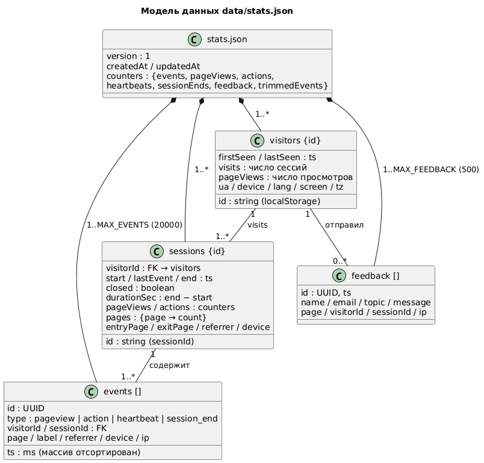

| Сущность | Ключевые поля | Назначение |
|---|---|---|
| `visitor` | `id`, `firstSeen`, `lastSeen`, `visits`, `pageViews`, `ua`, `device`, `lang`, `screen`, `tz` | уникальные посетители, новые/вернувшиеся |
| `session` | `id`, `visitorId`, `start`, `lastEvent`, `end`, `closed`, `durationSec`, `pageViews`, `actions`, `pages{}`, `entryPage`, `exitPage`, `referrer`, `device` | длительность сессий, глубина, отказ, вход/выход |
| `event` | `id`, `ts`, `type`, `visitorId`, `sessionId`, `page`, `label`, `referrer`, `device`, `ip` | просмотры страниц, нажатия кнопок, heartbeat |
| `feedback` | `ts`, `name`, `email`, `message`, `page` | демонстрация обработки web-формы |

Типы событий: `pageview` (просмотр страницы), `action` (нажатие кнопки формы), `heartbeat` (страница открыта), `session_end` (страница закрыта).

### Шаг 2. Реализовал сервер и хранение

Сервер — один файл `server/server.js` на встроенном `http`: маршрутизация `/api/*`, раздача статики из `public/`, лимит тела запроса, CSV-экспорт. Хранение — `server/storage.js`: загрузка JSON при старте, накопление событий в памяти, асинхронная запись на диск с debounce 400 мс, ограничение размера (20000 событий, 5000 сессий).

Ошибки, найденные при проверке демо-данных и исправленные:

| Проблема | Симптом | Исправление |
|---|---|---|
| Суффикс `#N` добавлялся идентификатору сессии даже без конфликта | 35 реальных сессий считались как 85 | суффикс создаётся только при коллизии: `while (state.sessions[sessionId]) { … }` |
| События добавлялись в массив не по времени | `firstEvent > lastEvent`, пустые окна таймлайна, неверное усечение | `insertEvent()` — бинарная вставка по `ts`, массив событий всегда отсортирован |
| Внешние источники не появлялись в статистике | все демо-сессии помечались «внутренними» | в `seed.js` список referrer-ов был без весов, `pickWeighted` всегда возвращал последний элемент; referrer-ы стали взвешенными |
| «Внутренний переход» определялся только по Host заголовку | сайт, открытый по `localhost` и по `127.0.0.1`, считался внешним | клиент передаёт `origin` своей страницы, сервер сравнивает хост referrer-а с хостом страницы |

### Шаг 3. Описал API

| Метод и маршрут | Назначение | Ответ |
|---|---|---|
| `GET /api/health` | проверка живости, версия, время работы | JSON |
| `GET /api/stats?range=&page=&limit=` | полный отчёт для дашборда | JSON с KPI, таймлайном, топ-страницами, устройствами, сессиями |
| `GET /api/pages` | список страниц для селектора формы отчёта | JSON |
| `GET /api/sessions?limit=` | последние сессии | JSON |
| `GET /api/feedback` | отзывы, отправленные через форму | JSON |
| `POST /api/events` | приём события трекера (`pageview`, `action`, `heartbeat`) | `201` + краткая сводка |
| `POST /api/session-end` | закрытие сессии, фиксация длительности | JSON с сессией |
| `POST /api/feedback` | сохранение web-формы | `201` + запись |
| `GET /api/export.csv?type=timeline\|pages\|sessions` | выгрузка CSV (`;` как разделитель, UTF-8 BOM для Excel) | `text/csv` |
| `POST /api/seed` | добавить демонстрационные данные | JSON |
| `POST /api/reset` | очистить статистику | JSON |

### Шаг 4. Реализовал асинхронный сбор данных через JS

Клиентский трекер `public/js/tracker.js` отправляет события фоново, не мешая работе страницы.

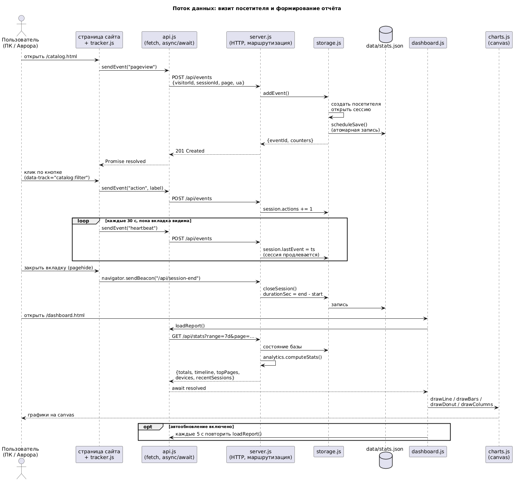

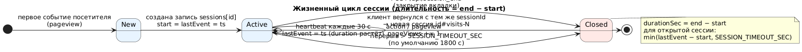

```js
async function postJson(url, payload, useKeepalive) {
  var response = await fetch(url, {
    method: 'POST',
    headers: { 'Content-Type': 'application/json' },
    body: JSON.stringify(payload),
    keepalive: Boolean(useKeepalive),
    cache: 'no-store',
    credentials: 'omit'
  });
  if (!response.ok) throw new Error('HTTP ' + response.status);
  return response.json().catch(function () { return {}; });
}

/** Отправляет событие; при неудаче кладёт его в очередь на повтор. */
async function sendEvent(type, extra) {
  if (!consent) return null;
  var payload = basePayload();
  payload.type = type;
  try {
    var result = await postJson(EVENT_URL, payload, false);
    flushQueue();
    return result;
  } catch (err) {
    if (queue.length < MAX_QUEUE) queue.push(payload);
    return null;
  }
}
```

Что делает трекер:

| Действие браузера | Событие на сервер | Когда |
|---|---|---|
| Открыл страницу | `pageview` (page, origin, referrer, ua, lang, screen, tz) | при загрузке |
| Нажал кнопку формы | `action` + `label` (например `catalog:filter`, `dashboard:apply`) | при клике |
| Страница открыта | `heartbeat` | каждые 30 с |
| Закрыл вкладку / ушёл | `session_end` через `fetch(keepalive)` или `navigator.sendBeacon` | `pagehide` / `visibilitychange` |
| Сеть недоступна | событие попадает в очередь и досылается через `flushQueue()` | при следующем успехе |

Логика сессии на сервере: событие того же `sessionId` продлевает сессию; если между событиями прошло больше `SESSION_TIMEOUT_SEC` (1800 с) — старая сессия закрывается с `durationSec = lastEvent − start`, а новая начинается.

### Шаг 5. Формулы метрик

| Метрика | Формула |
|---|---|
| Просмотры страниц | `Σ events.type == 'pageview'` |
| Уникальные посетители | число `visitors`, попавших в выбранный период |
| Новые / вернувшиеся | `firstSeen` внутри периода / вне периода |
| Длительность сессии | `(end − start) / 1000`, где `end = lastEvent` при закрытии |
| Средняя длительность сессии | `Σ durationSec / sessions` |
| Глубина просмотра | `Σ pageViews / sessions` |
| Показатель отказов | `сессии с pageViews == 1 / sessions × 100 %` |
| Активные сейчас | сессии с событием за последние 5 минут |
| Тип устройства | по User-Agent: `aurora` → `mobile` → `tablet` → `desktop` |
| Источник перехода | пусто → «прямой заход»; хост referrer == хост страницы (`origin`) → «внутри сайта»; иначе внешний хост |

### Шаг 6. Web-интерфейс и обработка нажатий кнопок

| Страница | Форма и кнопки | Обработчик | Что происходит |
|---|---|---|---|
| `index.html` | живые счётчики, кнопка меню `#navToggle` | `app.js` | `GET /api/stats` через `async/await`, обновление счётчиков, отправка `action` при открытии меню |
| `catalog.html` | форма `#filterForm`: `#category`, `#maxPrice`, `#search`, кнопка «Применить», кнопка «Показать ещё» | `app.js` | `submit` + `preventDefault()`, фильтрация без перезагрузки страницы, `POST /api/events` с `label: catalog:filter` |
| `contact.html` | форма `#feedbackForm`: имя, e-mail, тема, сообщение; кнопки `#sendFeedback` и `#clearFeedback` | `app.js` | клиентская валидация, `POST /api/feedback`, вывод ошибок в `#formMessages`, обновление таблицы `#feedbackTable` |
| `dashboard.html` | форма отчёта `#reportForm`: период `#range`, страница `#page`, лимит `#limit`, автообновление `#autoRefresh`; кнопки «Применить», «Обновить», «Демо-данные», «Экспорт CSV», «Сбросить» | `dashboard.js` | `loadStats()` — `async`, параллельные запросы через `Promise.all`, перерисовка KPI, графиков и таблиц, `setInterval` на 5 с |
| все страницы | — | `tracker.js` | асинхронная отправка статистики |

### Шаг 7. Адаптивная вёрстка через `@media`

| Правило | Что меняется |
|---|---|
| `@media (max-width: 992px)` | сетка карточек в 2 колонки, панель статистики в 1 колонку, canvas на всю ширину |
| `@media (max-width: 768px)` | горизонтальное меню заменяется кнопкой `#navToggle`, KPI-сетка в 2 колонки, таблицы прокручиваются горизонтально |
| `@media (max-width: 480px)` | одна колонка, формы на всю ширину, шрифт 15 px, кнопки формы отчёта друг под другом |
| `@media (prefers-color-scheme: dark)` | тёмная палитра (удобно на AMOLED-телефоне) |
| `@media print` (dashboard.css) | печать отчёта без кнопок и меню |

### Шаг 8. Визуализация результатов

Дашборд рисует 4 графика на `<canvas>` собственным кодом (`charts.js`): линия/площадка по времени, горизонтальные бары по страницам, кольцевая диаграмма устройств, гистограмма длительности сессий. Canvas пересчитывается при изменении размера окна с учётом `devicePixelRatio`, поэтому графики корректны и на ПК, и на телефоне.

Те же данные в отчёте визуализированы скриптом `report/src/python/make_charts.py` (matplotlib) напрямую из файла статистики.

**Просмотры страниц по времени (корзины по 6 часов, 7 дней):**

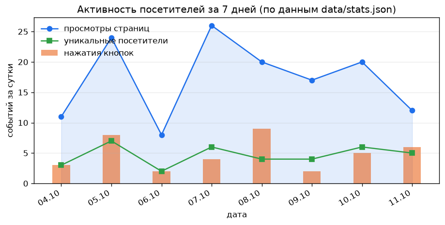

**Популярные страницы:**

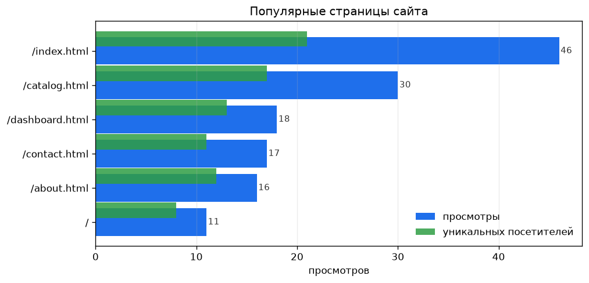

**Устройства посетителей (диаграмма):**

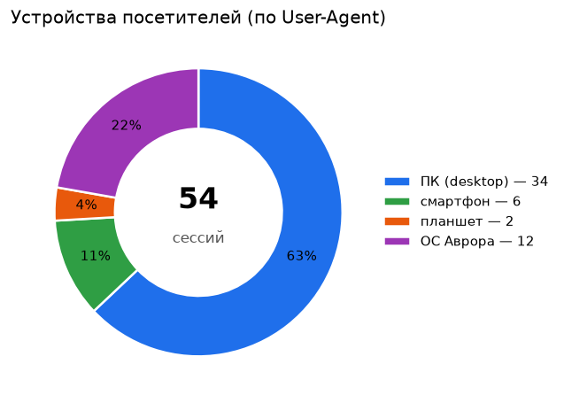

**Распределение сессий по длительности:**

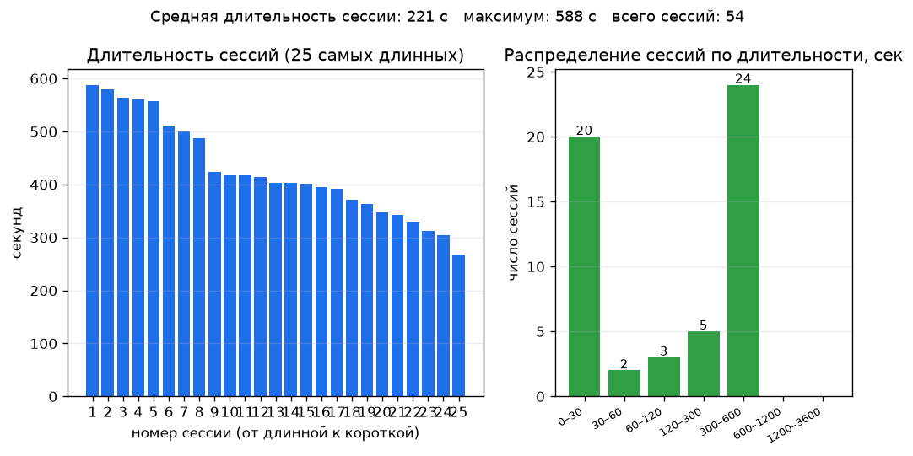

**Источники переходов:**

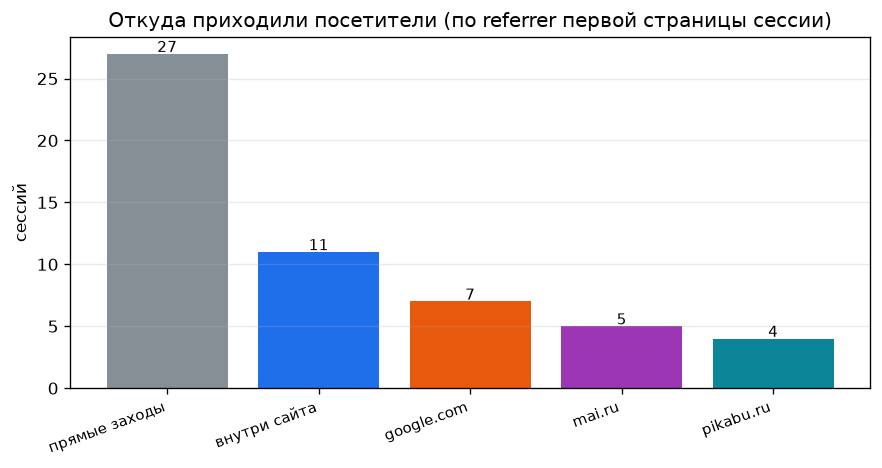

**Сводка ключевых показателей:**

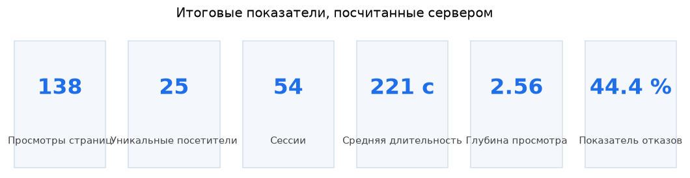

### Шаг 9. Архитектура целиком

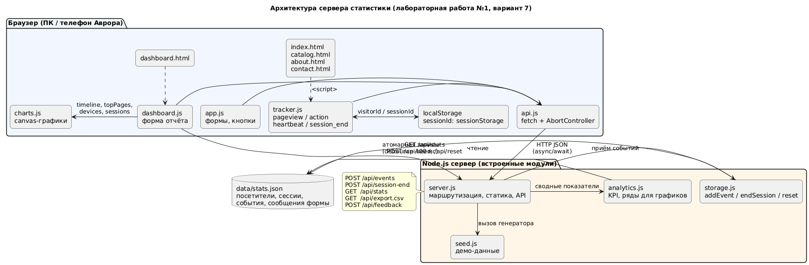

| Модуль | Ответственность |
|---|---|
| `server/server.js` | HTTP, маршруты, валидация тела, раздача статики, CSV, печать адресов локальной сети |
| `server/storage.js` | загрузка/сохранение JSON, посетители, сессии, сортировка событий, лимиты |
| `server/analytics.js` | агрегаты: KPI, таймлайн, топ страниц, устройства, длительности, источники |
| `server/seed.js` | детерминированный генератор демо-посетителей за N дней |
| `public/js/tracker.js` | асинхронный сбор статистики с клиента |
| `public/js/api.js` | `async`-обёртка `fetch` + `AbortController` (таймаут 8 с) |
| `public/js/charts.js` | рисование графиков на canvas |
| `public/js/dashboard.js` | форма отчёта, KPI, графики, таблицы, автообновление |
| `public/js/app.js` | меню, счётчики, фильтр каталога, форма отзывов |

---

## 5. Тестирование

| Тест | Что проверяет | Результат |
|---|---|---|
| `npm test` (`test/api-test.js`) | реальный запуск сервера на тестовом порту, все маршруты `/api/*`, раздача статики, метрики, CSV, ошибки 400/404/422 | **33 из 33 проверок пройдено** |
| `npm run test:ui` (`test/frontend-smoke.js`) | загрузка страниц в jsdom, выполнение клиентского JS, наличие KPI и таблиц дашборда, отправка событий трекером | **16 из 16 проверок пройдено** |

Примеры проверок API-теста (названия — из вывода теста):

- `POST /api/events принимает pageview` → ответ `201`;
- `просмотры страниц посчитаны` → `pageViews = 3`;
- `уникальные посетители посчитаны` → `uniqueVisitors = 2`;
- `сессии посчитаны`, `нажатия кнопок посчитаны`, `длительность сессии посчитана`;
- `устройства определены по User-Agent (Аврора)` → `devices.aurora = 1`;
- `внутренние переходы определены по origin страницы` → `sources.internal = 1`;
- `POST /api/session-end закрывает сессию` → `session.closed === true`;
- `форма с ошибками получает 422 и список ошибок`, `корректная форма принимается (201)`;
- `экспорт CSV работает` (колонки `page;views;visitors` для типа `pages`);
- `CSS содержит адаптивные @media-правила`, `tracker.js использует async/await и fetch`, `api.js использует Promise/AbortController` — то есть требования задания проверяются тестом автоматически;
- `битый JSON даёт 400`, `неизвестный API-метод даёт 404`, `путь за пределы public недоступен`.

Особенность, найденная при тестировании интерфейса: в jsdom нет настоящего canvas, `getContext('2d')` возвращает `null`, и код графиков падал до отрисовки таблицы сессий. В тест добавлена заглушка `canvasStub()`, а в `charts.js` — проверка доступности контекста, поэтому страница не ломается в браузере без canvas.

---

## 6. Демонстрация работы

### 6.1 Запуск в локальной сети

```bash
cd lab01-stat-server
npm install          # не обязателен: сервер работает без зависимостей
npm run seed         # наполнить статистику демонстрационными данными
npm start
```

Вывод сервера при реальном запуске:

```
  Сервер статистики аналитики сайта (вариант 7) запущен
  ─────────────────────────────────────────────────────
  На этом ПК:      http://localhost:3000/
  Дашборд:         http://localhost:3000/dashboard.html
  В локальной сети: http://192.168.1.211:3000/   (enp8s0)
  В локальной сети: http://192.168.1.212:3000/   (enp8s0)
  На телефоне (Аврора) откройте адрес из строки «В локальной сети».
```

Сервер слушает `0.0.0.0`, поэтому телефон в той же Wi-Fi сети открывает `http://192.168.1.211:3000/`.

### 6.2 Сводка за демонстрационный прогон

Прогон: десктопный браузер (1440×1000) + мобильный браузер с User-Agent Аврора (390×844), 12 страниц, форма фильтра, форма обратной связи, форма отчёта.

| Показатель | Значение |
|---|---|
| Просмотры страниц | 138 |
| Уникальные посетители | 25 |
| Сессии | 54 (из них 12 открыты) |
| Средняя длительность сессии | 221 с (3 мин 41 с) |
| Максимальная длительность сессии | 588 с |
| Глубина просмотра | 2,56 страницы на сессию |
| Показатель отказов | 44,4 % |
| Нажатия кнопок (actions) | 39 |
| Устройства | desktop 34, aurora 12, mobile 6, tablet 2 |
| Источники переходов | прямые 27, внутри сайта 11, google.com 7, mai.ru 5, pikabu.ru 4 |

### 6.3 Скриншоты: браузер десктопной ОС

**Главная страница с живыми счётчиками статистики:**

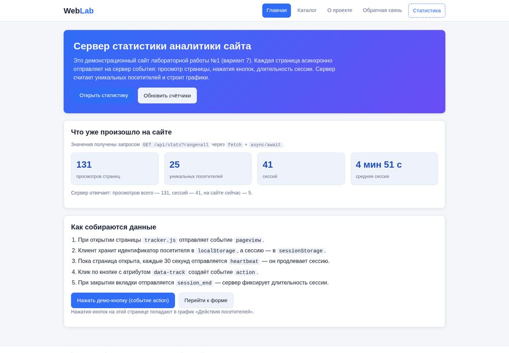

**Каталог до применения фильтра (показано 6 из 12):**

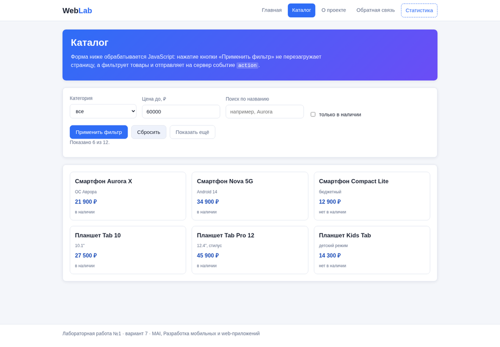

**Каталог после нажатия кнопки «Применить» в форме фильтра (показано 4 из 4: «Смартфон Aurora X», «Смартфон Nova 5G», «Смартфон Compact Lite», «Смартфон Aurora Pro»; страница не перезагружалась):**

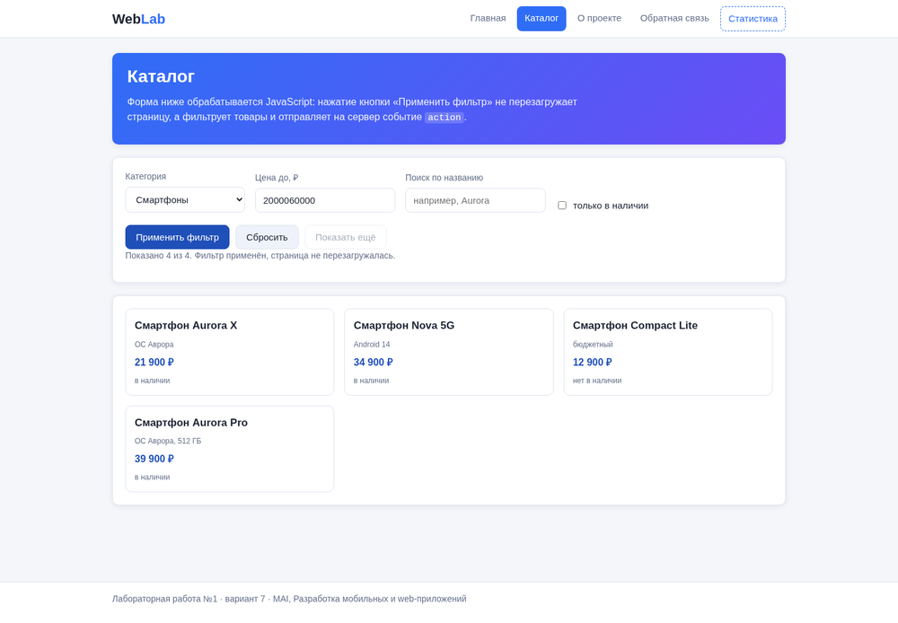

**Форма обратной связи: сервер вернул ошибки валидации — «Укажите имя (минимум 2 символа). Некорректный e-mail. Сообщение слишком короткое (минимум 5 символов).»**

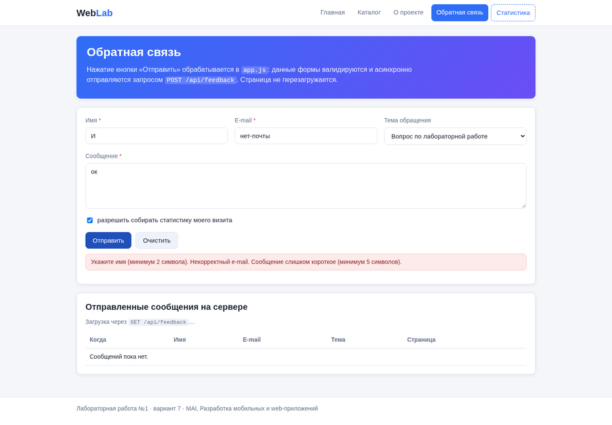

**Та же форма отправлена корректно: запись появилась в таблице отзывов без перезагрузки страницы:**

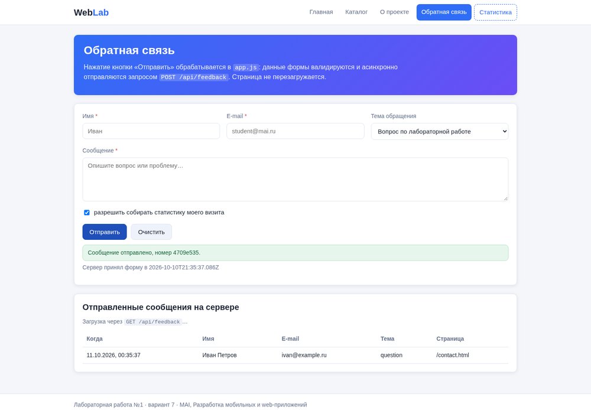

**Панель статистики: KPI, 4 графика на canvas, таблица последних сессий и таблица источников:**

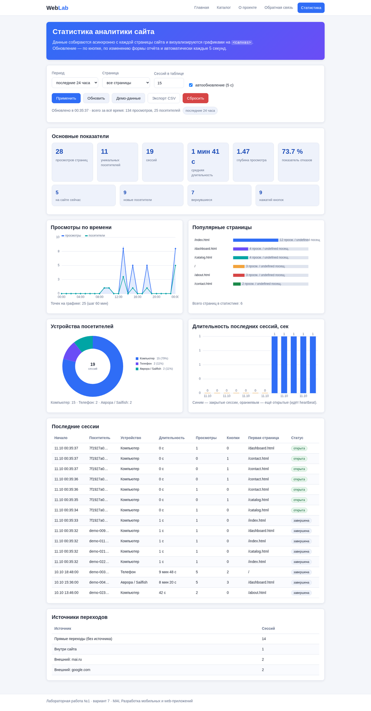

**Панель статистики после применения формы отчёта (период «последние 7 дней», страница `/catalog.html`; KPI: 77 просмотров, 21 посетитель, 22 сессии, средняя длительность 5 мин 19 с):**

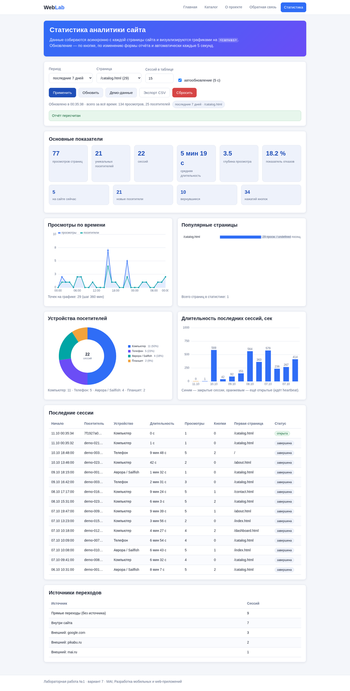

### 6.4 Скриншоты: мобильный браузер (ОС Аврора)

Снимки сделаны в мобильном окне 390×844 с User-Agent Аврора (`… Aurora Browser/2.0.0.21`), поэтому сервер отнёс эти визиты к устройству `aurora` — 12 сессий в сводке.

**Главная страница на телефоне (адаптивная вёрстка, брейкпоинт 480 px):**

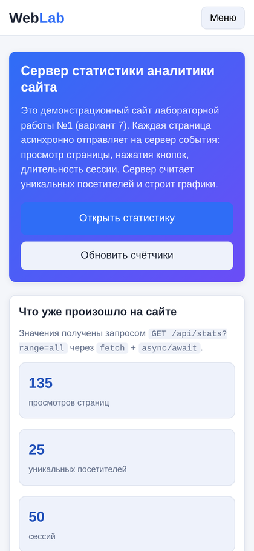

**Меню открыто кнопкой `#navToggle`:**

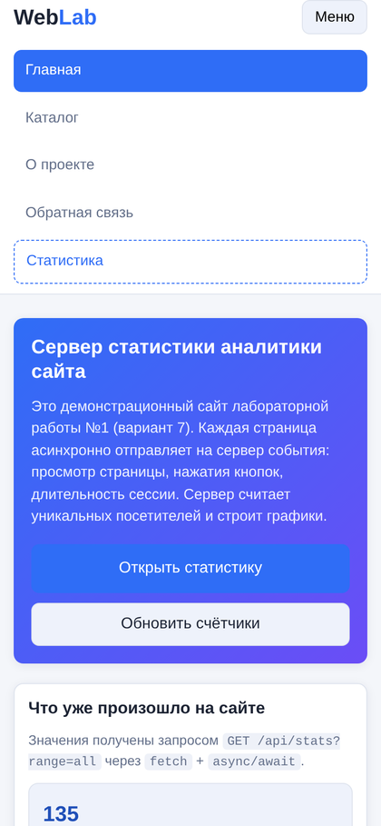

**Каталог на телефоне, форма фильтра на всю ширину:**

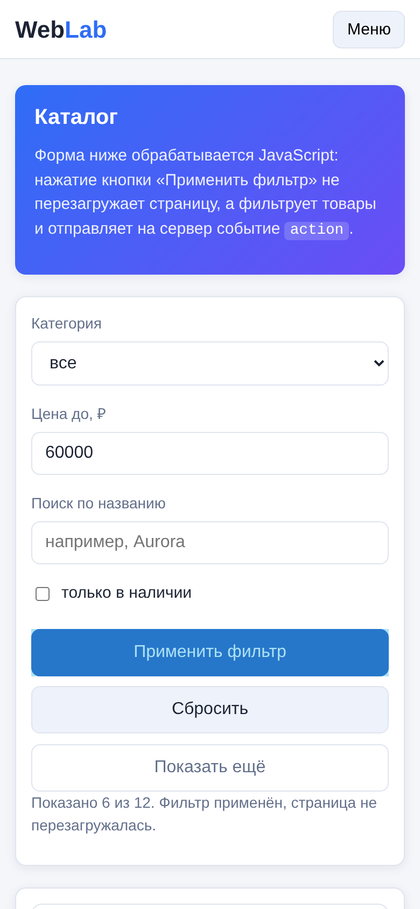

**Панель статистики на телефоне: KPI в 2 колонки, графики на всю ширину (canvas 672×400 px при `devicePixelRatio` 2):**

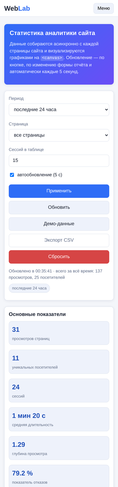

**Диаграмма устройств на десктопном дашборде (доля Аврора и мобильных визитов):**

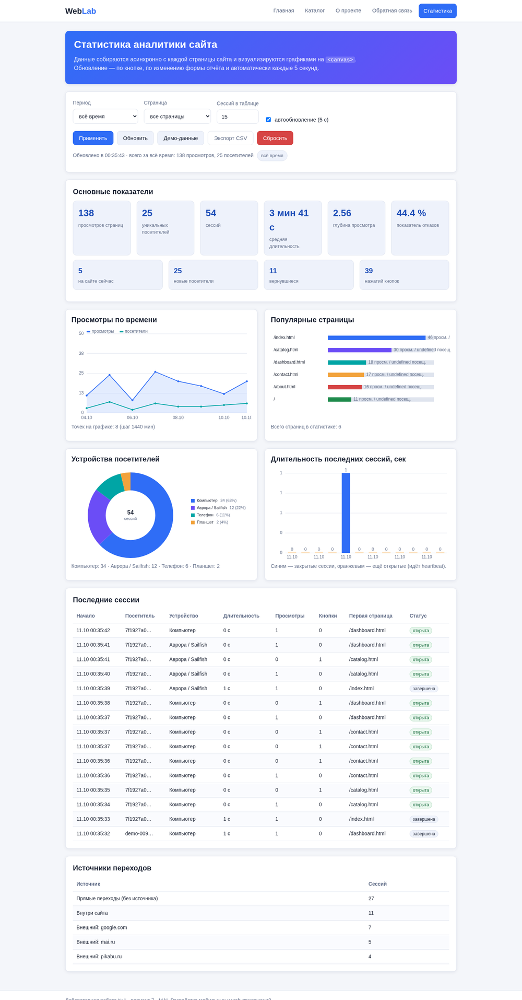

---

## 7. Проверка требований варианта №7

| Требование варианта | Подтверждение в работе |
|---|---|
| Количество просмотров страниц | KPI «Просмотры страниц» = 138, график «Просмотры по времени», таблица топ-страниц, `GET /api/export.csv?type=pages` |
| Уникальные посетители | KPI «Уникальные посетители» = 25, разбивка «новые / вернувшиеся», `visitorId` в `localStorage` |
| Длительность сессий | KPI «Средняя длительность сессии» = 3 мин 41 с, гистограмма длительностей, таблица сессий с колонкой «Длительность» |
| Асинхронный сбор через JS | `async/await` + `fetch` в `tracker.js`, heartbeat каждые 30 с, `sendBeacon` при уходе со страницы, очередь повторных отправок |
| Сохранение на сервере | `data/stats.json`: посетители, сессии, события, отзывы; асинхронная запись с debounce 400 мс |
| Визуализация графиками или диаграммами | 4 canvas-графика на дашборде + 6 графиков matplotlib в этом отчёте |

---

## 8. Выводы

1. Разработан сервер статистики аналитики сайта, удовлетворяющий варианту №7: собирает просмотры страниц, уникальных посетителей и длительность сессий, хранит данные на сервере и визуализирует их графиками и диаграммами.
2. Взаимодействие с пользователем идёт через браузер: пять HTML-страниц, CSS с адаптивной сеткой на трёх брейкпоинтах и тёмной темой, JavaScript с обработчиками кнопок web-форм (фильтр каталога, форма обратной связи, форма отчёта).
3. Асинхронность реализована с обеих сторон: клиент отправляет события через `fetch`/`async-await`/`sendBeacon` и загружает отчёт параллельными запросами через `Promise.all`; сервер пишет файл статистики асинхронно.
4. Приложение запускается в локальной сети и демонстрируется в браузере ПК и в мобильном браузере Аврора; сервер сам печатает адреса для телефона.
5. Работа проверена автоматическими тестами: 33 проверки API и 16 проверок клиентского интерфейса; требования задания (async/await в JS, `@media` в CSS) проверяются тестами напрямую.
6. В ходе работы найдены и исправлены четыре реальные ошибки учёта: дублирование идентификаторов сессий, нарушение хронологии событий, потеря внешних источников переходов, неверное определение внутренних переходов. Каждая исправленная ситуация теперь отражена в тестах или видна в сводке.

---

## 9. Как воспроизвести материалы отчёта

Все исходники визуализации сохранены в `report/src/`, графики и схемы не рисовались вручную:

| Материал | Исходник | Команда воспроизведения |
|---|---|---|
| Схемы: архитектура, модель данных, последовательность сбора, жизненный цикл сессии | `report/src/plantuml/*.puml` | `PLANTUML_JAR=/path/to/plantuml.jar bash report/src/plantuml/render.sh` (нужны Java и Graphviz) |
| Графики отчёта (6 шт.) | `report/src/python/make_charts.py` | `python3 report/src/python/make_charts.py`; чтобы графики совпали со скриншотами: `DATA_FILE=report/.screens-data/stats.json python3 report/src/python/make_charts.py` |
| Скриншоты приложения | `report/src/screenshots/capture.js` | `CHROME_PATH=/usr/bin/google-chrome-stable node report/src/screenshots/capture.js` (скрипт сам поднимает сервер на тестовом порту с демо-данными) |
| Уменьшение скриншотов для встраивания в отчёт | `report/src/screenshots/prepare-for-report.sh` | `bash report/src/screenshots/prepare-for-report.sh` |
| Сводка визитов демонстрационного прогона | — | `report/screenshots/capture-summary.json` (создаётся скриптом снимков) |

Схемы также сохранены в SVG (`report/images/*.svg`) — их можно править без перерисовки.

### 9.1 Подготовка DOCX-версии отчёта

Pandoc в системе нет, поэтому цепочка такая: Markdown → HTML (модуль Python `markdown`) → DOCX через LibreOffice.

```bash
mkdir -p report/build
python3 - <<'PY'
import markdown, pathlib
html = markdown.markdown(
    pathlib.Path('REPORT.md').read_text(encoding='utf-8'),
    extensions=['tables', 'fenced_code'],
)
pathlib.Path('report/build/report.html').write_text(
    '<meta charset="utf-8">\n' + html, encoding='utf-8')
PY
libreoffice --headless --convert-to docx --outdir report/build report/build/report.html
```

Изображения указаны относительными путями (`report/images/…`, `report/screenshots/report/…`), поэтому DOCX нужно собирать из каталога `lab01-stat-server/`.

---

## 10. Полезные команды

| Команда | Действие |
|---|---|
| `npm start` | запуск сервера на `http://0.0.0.0:3000` |
| `npm run dev` | запуск с автоперезапуском |
| `npm run seed` | добавить демонстрационные данные (24 посетителя, 7 дней) |
| `npm run reset` | очистить статистику |
| `npm test` | интеграционный тест API (33 проверки) |
| `npm run test:ui` | smoke-тест клиентского интерфейса (16 проверок) |
| `PORT=8080 npm start` | запустить на другом порту |
| `SEED_ON_START=1 npm start` | запустить и сразу наполнить статистику |
| `TEST_PORT=4111 npm test` | выбрать порт для теста |

Подробная документация — в каталоге `docs/`:

| Файл | Содержание |
|---|---|
| `docs/01-zadanie.md` | задание и разбор варианта |
| `docs/02-arhitektura.md` | архитектура сервера и клиента |
| `docs/03-api.md` | описание всех маршрутов и форматов ответов |
| `docs/04-metriki.md` | формулы метрик и правила закрытия сессий |
| `docs/05-tracker.md` | как работает клиентский сбор статистики |
| `docs/06-interface.md` | страницы, формы, кнопки, адаптивная вёрстка |
| `docs/07-zapusk-i-proverka.md` | запуск, тесты, чек-лист демонстрации |
| `docs/08-aurora.md` | особенности браузера Аврора и доступ по локальной сети |
| `docs/09-faq.md` | частые вопросы |
