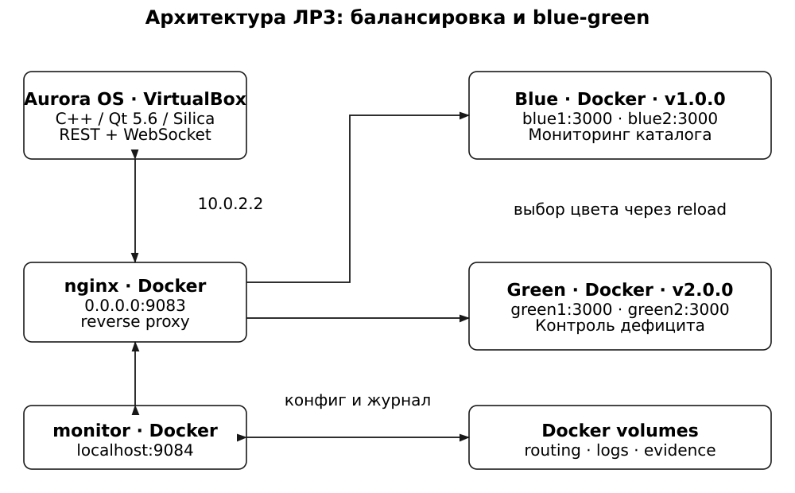
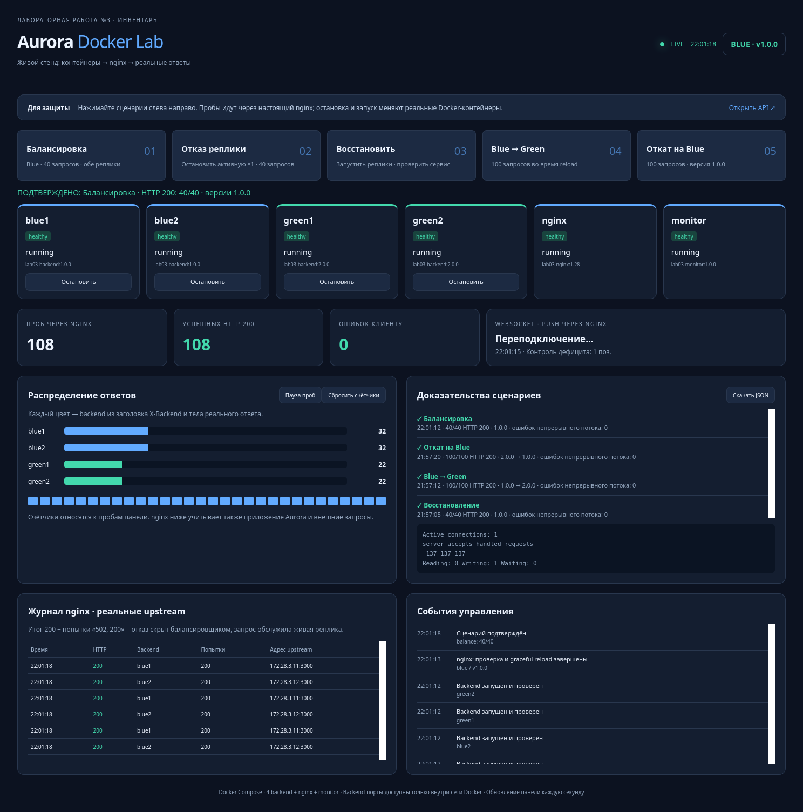
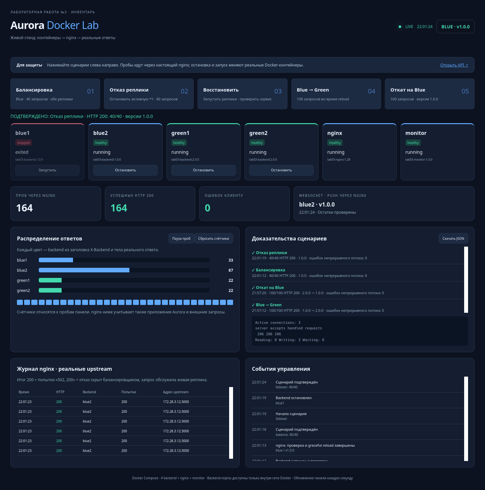
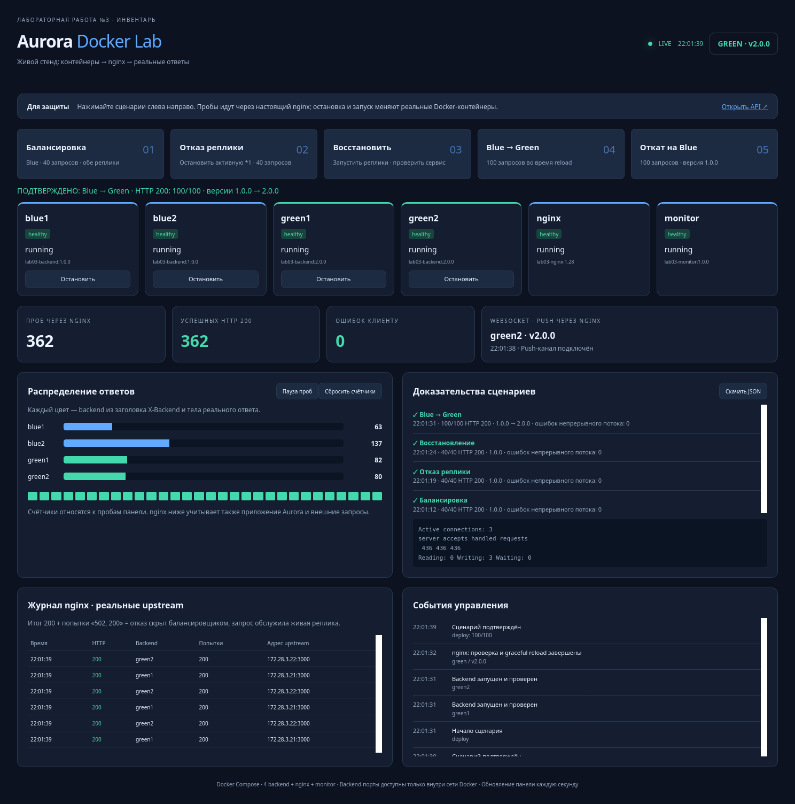
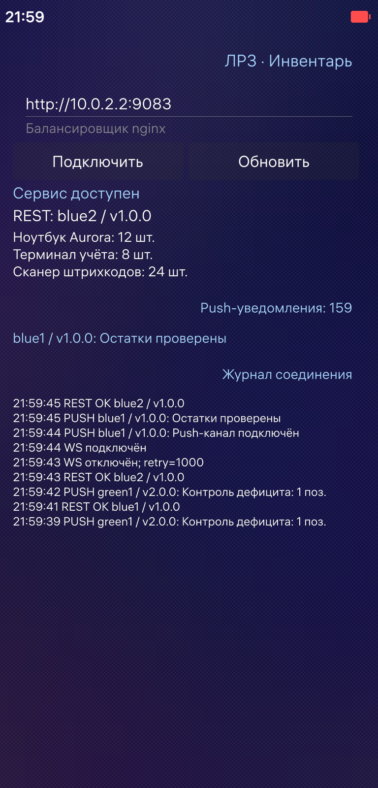
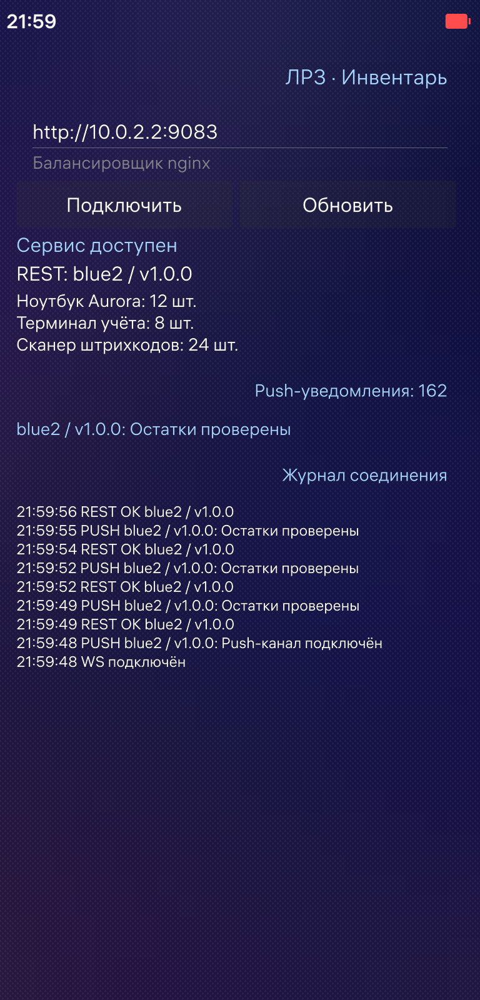
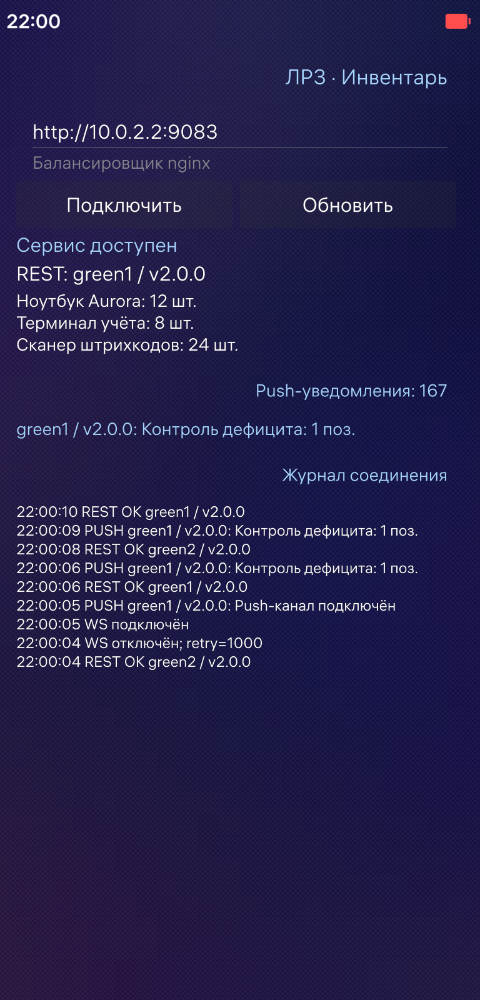
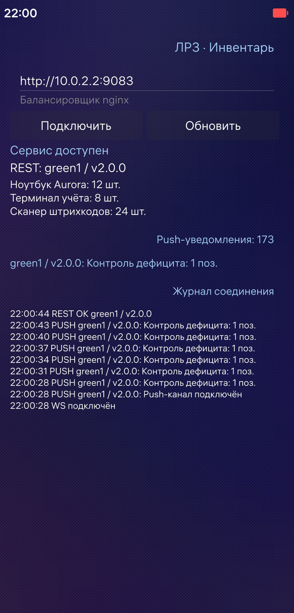

# Лабораторная работа №3

## ВВЕДЕНИЕ

Цель работы — освоить сборку и подпись RPM приложения Aurora OS, контейнерное развёртывание нескольких экземпляров серверного приложения, балансировку нагрузки, обновление blue-green и восстановление соединений нативного клиента при отказах.

Для варианта №7 «Инвентарь» разработал самостоятельный сервис мониторинга каталога, нативный клиент Aurora OS и веб-панель демонстрации. Все серверные компоненты разместил в Docker Compose: четыре backend, nginx и мониторинг. На хосте отдельные процессы сервера и службы лабораторной работы не запускаются. Панель показывает реальные состояния контейнеров, распределение ответов и результаты проверяемых сценариев.

## 1 Постановка задачи и условия выполнения

Работа включает развёртывание нескольких экземпляров приложения, reverse proxy nginx, балансировку, автоматическое восстановление, обновление blue-green и проверку отказоустойчивости. Для мобильной части необходимо собрать и подписать RPM, настроить работу через балансировщик, WebSocket push и повторные попытки соединения.

Мобильные испытания проводились в Oracle VirtualBox VM Aurora OS, вместо физического телефона. Для сборки использован Docker-контейнер Aurora SDK.

В установленном SDK 5.1 отсутствует команда sign_package. Для подписи применён штатный инструмент rpmsign-external и имеющийся тестовый сертификат разработчика SDK.

**Соответствие задачам работы**

| Задача | Реализация |
|---|---|
| Контейнерное развёртывание | Docker Compose, отдельные контейнеры nginx, monitor и четырёх backend |
| Балансировка | Две активные реплики выбранного релиза, round-robin |
| Автовосстановление | restart: unless-stopped, healthcheck контейнеров |
| Обновление | Проверка целевой пары, nginx -t, graceful reload и откат |
| Наблюдаемость | Docker Engine API, пробы REST, JSON access log, nginx stub_status |
| RPM | rpmbuild в Docker-среде Aurora SDK, подпись и проверка |
| Нативный клиент | Qt 5.6/Silica, REST через nginx, WebSocket и backoff |
| Демонстрация | Пять кнопок проверяемых сценариев, экспорт JSON-доказательств |

## 2 Среда и архитектура

### 2.1 Состав стенда

| Компонент | Конфигурация |
|---|---|
| Контейнеризация | Docker Engine, контекст default, Compose, bridge-сеть inventory |
| Backend | Node.js 22 Alpine, только стандартные модули |
| Балансировщик | nginx 1.28 Alpine, опубликованный порт 9083 |
| Панель | Node.js, HTML/CSS/JavaScript, 127.0.0.1:9084 |
| Сборка Aurora | SDK 5.1.1.60-base, Qt 5.6.3, Docker build engine |
| Мобильные испытания | Oracle VirtualBox, AuroraOS-5.1.1.60-base-x86_64 |
| Сеть мобильного клиента | VirtualBox NAT, http://10.0.2.2:9083 |



В Compose создано шесть постоянно работающих контейнеров. Реплики blue1 и blue2 выполняют версию 1.0.0, green1 и green2 — версию 2.0.0. Все backend слушают порт 3000 внутри Docker и не публикуют его на хост. nginx принимает запросы на 9083 и направляет их активной паре. Панель на 9084 выполняет наблюдение и управление. Дополнительный контейнер tests запускается только на время автоматической проверки.

**Роли контейнеров**

| Сервис | Образ и назначение |
|---|---|
| blue1, blue2 | lab03-backend:1.0.0, исходный мониторинг остатков |
| green1, green2 | lab03-backend:2.0.0, контроль дефицита |
| nginx | lab03-nginx:1.28, reverse proxy и балансировка |
| monitor | lab03-monitor:1.0.0, панель, пробы и управление сценариями |

Для версий backend используются разные Docker-образы. Green добавляет признак lowStock для остатка менее 10 и поле lowStockCount в push, сохраняя совместимость с клиентом. Каталог содержит ноутбук Aurora — 12, терминал учёта — 8, сканер штрихкодов — 24: всего 44 единицы и одна дефицитная позиция. Каталог используется только для чтения; конкурирующей записи между репликами нет.

### 2.2 Сеть и постоянные данные

Сервисы размещены в Docker-сети 172.28.3.0/24. Blue имеет постоянные адреса .11/.12, Green — .21/.22. Панель получает адреса через Docker inspect и записывает их в upstream. Это позволяет запускать nginx даже при намеренно остановленной реплике, DNS-имя которой Docker временно не разрешает. Для backend отсутствуют обращения к хосту через host-gateway и отдельные слушающие порты ПК. nginx доступен мобильному клиенту по прежнему адресу 10.0.2.2:9083.

Конфигурация активного upstream хранится в volume routing, журнал nginx — в nginx-logs, история результатов — в evidence. Данные сохраняются после docker compose down и повторного up. Состояния контейнеров и health берутся из Docker Engine API; график распределения строится по заголовку X-Backend фактически полученного ответа.

Панель управления опубликована только на loopback хоста. Для запуска и остановки разрешены четыре backend данного Compose-проекта. Произвольные имена контейнеров не принимаются. Браузерные запросы управления проверяются по Origin.

## 3 Реализация серверной инфраструктуры

### 3.1 REST, push и образы backend

GET /api/health возвращает status, instance, version и время. GET /api/items возвращает каталог и те же метаданные. Заголовки X-Backend и X-App-Version позволяют связать ответ с репликой. Cache-Control: no-store исключает кэширование измерений.

После WebSocket Upgrade сервер отправляет hello, а каждые три секунды — inventory с backend, версией, временем, последовательностью и суммарным остатком. Релиз 2 дополнительно сообщает число дефицитных позиций. Это результат периодической серверной проверки каталога. Sequence локален для экземпляра. Heartbeat ping/pong выполняется каждые пять секунд.

Dockerfile backend основан на node:22-alpine, копирует исходники в образ и запускает Node.js от непривилегированного пользователя node. Аргумент RELEASE определяет модуль релиза. Healthcheck обращается к локальному /api/health. Запуск всех компонентов выполняется одной командой:

```bash
./lab03/lab up -d --build --wait
```

В Compose задано restart: unless-stopped. Контейнеры восстанавливаются после аварии и запуска Docker Engine, если не были намеренно остановлены. Серверный стенд использует native Docker Engine, контекст default. Системная служба docker имеет состояния active и enabled: systemd запускает Docker, а Docker восстанавливает контейнеры. Команда lab фиксирует контекст только для этого проекта. Старые службы lab03-backend@ и lab03-nginx на хосте остановлены и отключены; управление приложениями перенесено в Docker.

### 3.2 Балансировщик nginx

В upstream inventory включаются две реплики выбранного релиза. Используется round-robin, max_fails=1 и fail_timeout=2s. Для сетевых ошибок и ответов 502/503/504 включён proxy_next_upstream, не более двух попыток. Таймаут подключения — одна секунда. Повторы безопасны, поскольку приложение поддерживает чтение.

Для WebSocket передаются Upgrade и Connection, используется HTTP/1.1 и отключена буферизация. Таймаут чтения 12 с превышает интервалы push и heartbeat. REST idle keep-alive отключён, чтобы при смене worker не использовать закрытое простаивающее соединение.

В upstream используются постоянные внутренние адреса из Compose IPAM. Они сохраняются при stop/start и пересоздании контейнеров. Конфигурация nginx не зависит от доступности DNS-имени остановленного backend. После пересоздания всего стенда сохранённый выбор релиза остаётся действительным.

JSON access log содержит итоговый HTTP-статус, адреса upstream, статусы отдельных попыток, backend, версию и время запроса. Пара статусов «502, 200» либо «504, 200» при итоговом 200 доказывает повтор запроса балансировщиком к живой реплике. Конечный клиент при этом получает успешный ответ.

### 3.3 Blue-green и откат

Переключение выполняется мониторингом внутри Docker:

1. Проверить /api/health обоих backend целевого релиза.
2. Записать целевую пару в общий volume routing.
3. Выполнить nginx -t через Docker exec; при ошибке вернуть прежний конфиг.
4. Выполнить nginx -s reload, сохранив контейнер, master и опубликованный порт.
5. Проверить появление ожидаемой версии через nginx.
6. Новые запросы обслуживает целевая пара, старые worker завершаются постепенно.

Если новая версия не появилась, конфигурация возвращается к прежней паре. Неготовая целевая реплика не позволяет начать переключение. Операции управления сериализованы: параллельное изменение конфигурации из двух кнопок отклоняется.

worker_shutdown_timeout=5s ограничивает время старых WebSocket соединений. После их закрытия клиент переподключается. Непрерывность проверяется для REST; сохранение одного WebSocket/TCP соединения при смене релиза не требуется.

## 4 Панель мониторинга и демонстрации

### 4.1 Источники наблюдения

Разработал локальную панель http://localhost:9084. Она объединяет шесть карточек контейнеров, состояния Docker health, активный релиз, счётчики успешных и ошибочных проб, распределение ответов по backend, push-канал, журнал nginx и события управления.

Monitor выполняет около четырёх проб в секунду через настоящий nginx. Каждый ответ сохраняется с временем, HTTP-статусом, backend, версией и задержкой. На уровне генератора автоматического повтора нет: ошибку балансировщика видно в счётчике. Кнопка «Пауза проб» останавливает фоновую нагрузку, а сброс счётчиков позволяет начать новую демонстрацию.

Панель запрашивает nginx stub_status и читает JSON access log. Эти данные включают также запросы Aurora и внешних клиентов. Счётчики собственных проб явно отделены от общего журнала nginx, поэтому их значения не обязаны совпадать.

### 4.2 Проверяемые сценарии

| Кнопка | Выполняемое действие и доказательство |
|---|---|
| Балансировка | Подготовка Blue, 40 запросов, ответы от обеих реплик |
| Отказ реплики | Docker stop активной реплики *1, 40 ответов от *2 |
| Восстановить | Docker start реплик, проверка готовности и 40 запросов |
| Blue → Green | 100 запросов до, во время и после reload, обе версии |
| Откат на Blue | 100 запросов и подтверждение обратного перехода |

Во время сценариев продолжаются фоновые пробы. Успех подтверждается только при отсутствии ошибок как в контрольной серии, так и в непрерывном потоке на её интервале. Для балансировки дополнительно проверяются обе реплики, для отказа — отсутствие ответов остановленного контейнера, для перехода между разными релизами — наличие обеих версий.

История сохраняется в Docker volume evidence. Кнопка «Скачать JSON» выгружает полные результаты: время, каждую пробу, распределение, ошибки и выдержку из nginx. Это позволяет показать доказательство независимо от текущих значений графика.







Для воспроизведения защиты подготовил DEMO.md: запуск стенда, демонстрация обеих реплик, остановка контейнера, восстановление, обновление и откат. При необходимости те же состояния проверяются стандартными docker compose ps, docker logs и docker stats.

## 5 Нативное приложение Aurora OS

### 5.1 Сетевой клиент

DeployClient предоставляет QML адрес, состояние сервиса, backend и версию, каталог, последний push, счётчик уведомлений и журнал. Адрес сохраняется в QSettings. Интерфейс содержит поле балансировщика и кнопки подключения и обновления.

QNetworkAccessManager запрашивает /api/items с собственным QTimer на три секунды. Одновременно выполняется один запрос. После успеха следующая проверка идёт через две секунды; при ошибках задержка увеличивается до 16 секунд и сбрасывается после восстановления. При смене URL устаревший ответ отбрасывается по номеру поколения.

QWebSocket переподключается через 1, 2, 4, 8 и 16 секунд. Watchdog проверяет отсутствие сообщений более 10 секунд. При недоступности обеих активных реплик последний каталог остаётся видимым, статус сообщает об ошибке и следующей попытке.

### 5.2 Сборка, подпись и установка

RPM собран для AuroraOS-5.1.1.60-base-x86_64. Команда sfdk build запускает rpmbuild, qmake и make в Docker-контейнере Aurora SDK. В spec заданы зависимости Qt5Core, Qt5Qml, Qt5Quick, Qt5Network, Qt5WebSockets и auroraapp.

```bash
# Рабочий каталог: lab03/aurora-app
~/AuroraOS/bin/sfdk -c target=AuroraOS-5.1.1.60-base-x86_64 build
python3 ../infra/sign-rpm.py
```

Получен пакет ru.mai.auroradeploy-1.0.0-1.x86_64.rpm. Сценарий подписи использует regular_cert.pem и regular_key.pem установленного SDK, выполняет sign/verify/dump внутри сборочного движка и удаляет временный ключ. Сертификат принадлежит developer/regular, имеет имя Noname developer (for testing only, do not use for production).

{{log:package-signature.log}}

Подписанный пакет установлен в VirtualBox штатным pkcon install-local. Журнал установки:

{{log:rpm-install.log}}

## 6 Экспериментальная проверка

### 6.1 Контейнерные проверки

Тест infrastructure-test.js запускается отдельным контейнером tests и обращается к API панели и настоящему nginx. Проверены пять сценариев, состояние остановленного контейнера, новый lowStock, отклонение нездорового Green, ограничения управления, JSON access log и stub_status.

```bash
./lab03/lab run --rm tests
```

{{log:docker-infrastructure-test.log}}

В контрольной серии отказа все 40 ответов получены от второй реплики. Во время обновления и отката успешны все 100 запросов. Распределение отдельной серии между двумя живыми репликами не обязано быть строго равным: одновременно работают фоновые пробы и мобильный клиент.

WebSocket проверен внутри Docker на обоих релизах. Проверяются hello, inventory, total=44, версия и lowStockCount=1 для Green. Соединение удерживается 11,5 с, более двух периодов heartbeat. Также проверены HTTP 405 и 404.

{{log:docker-ws-blue.log}}

{{log:docker-ws-green.log}}

### 6.2 Проверка интерфейса Firefox и перезапуска стенда

Сценарий browser-demo.js открывает настоящую страницу в Firefox, нажимает пять кнопок, дожидается результата в интерфейсе, сверяет JSON-доказательства и сохраняет снимки. Проверены шесть карточек и получение push через nginx.

{{log:browser-demo.log}}

Дополнительно выполнены docker compose down и повторный up --wait без удаления volumes. После пересоздания nginx продолжил обслуживать сохранённый Green-релиз, а история сценариев осталась доступна. Старые systemd-службы ЛР3 отключены, backend-порты 9311/9312/9321/9322 на хосте больше не слушаются.

### 6.3 Испытания приложения в VirtualBox

Сценарий emulator-demo.py выполняет пять этапов с одним работающим GUI-процессом. В каждом этапе проверяется, что PID не изменился. Начальный этап подтверждает REST и push от Blue.



Для отказа выбирается именно backend действующего push-соединения. Контейнер останавливается через Docker API, а клиент автоматически подключается к оставшейся реплике. REST ERROR при отказе одной реплики отсутствует.

{{log:02-backend-failure.log}}



После восстановления реплики выполнен переход на Green. REST получает версию 2.0.0, затем push-канал переподключается и передаёт сообщение «Контроль дефицита: 1 поз.». Приложение и его URL не меняются.

{{log:03-blue-green.log}}



Дополнительно остановлены обе активные Green-реплики. В этом случае новые данные недоступны: клиент показывает ошибку, сохраняет каталог и увеличивает задержки повторов. После запуска контейнеров REST и push возобновляются автоматически.

{{log:04-total-outage.log}}

{{log:05-recovered.log}}



Общий журнал мобильного сценария:

{{log:emulator-demo.log}}

### 6.4 Сводка результатов

| Проверка | Результат |
|---|---|
| Балансировка | 40/40, обе реплики Blue |
| Отказ контейнера | 40/40 через оставшуюся реплику |
| Восстановление | 40/40, обе реплики снова доступны |
| Blue-green | 100/100, версии 1.0.0 и 2.0.0 |
| Откат | 100/100, возврат на 1.0.0 |
| Нездоровый target | Переключение отклонено, прежняя пара отвечает |
| Интерфейс Firefox | Проверены все пять кнопок и push |
| Пересоздание Compose | Сохранены релиз и доказательства в volumes |
| Подпись RPM | Signatures successfully verified |
| Aurora | Отказ, обновление и восстановление без перезапуска GUI |

## ЗАКЛЮЧЕНИЕ

Разработал контейнерный стенд мониторинга инвентаря и нативный клиент Aurora OS. Все серверные сервисы разместил в Docker Compose. Настроил nginx, две пары релизов, healthcheck и restart policy. Для наблюдения реализовал панель с реальными данными Docker и nginx, генератором запросов и экспортом доказательств.

Проверил продолжение обслуживания при отказе одной реплики, обновление и откат без ошибок контрольной серии, получение push и автоматическое восстановление мобильного клиента. Подписанный RPM собран и установлен в эмуляторе Aurora OS. Для защиты подготовил воспроизводимый сценарий с пятью кнопками и снимками фактических результатов.

В локальном стенде применяется HTTP/WS. Каталог неизменяемый; доставка push не является долговечной очередью. Гарантия наблюдаемой непрерывности относится к REST; при завершении старого worker WebSocket переподключается. Эти особенности учтены в проверках и демонстрации.

## СПИСОК ИСПОЛЬЗОВАННЫХ ИСТОЧНИКОВ

1. Задание лабораторной работы №3. Файл lab03/TASK.md.
2. Материалы лабораторных работ №1–2. Каталоги lab01 и lab02.
3. Aurora SDK 5.1.1.60. Справка sfdk --help-building и rpmsign-external.
4. Docker Compose. Документация services, networks и volumes: https://docs.docker.com/compose/.
5. Docker Engine API. Управление контейнерами, inspect и exec: https://docs.docker.com/reference/api/engine/.
6. nginx. ngx_http_proxy_module и stub_status: https://nginx.org/en/docs/.
7. Fette I., Melnikov A. The WebSocket Protocol. RFC 6455, 2011.
