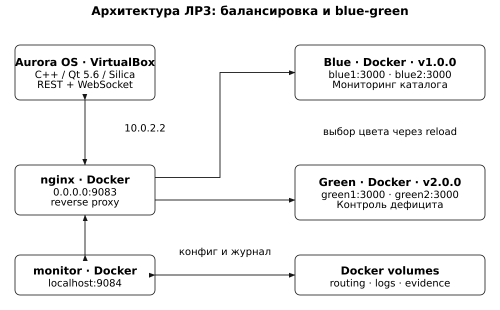
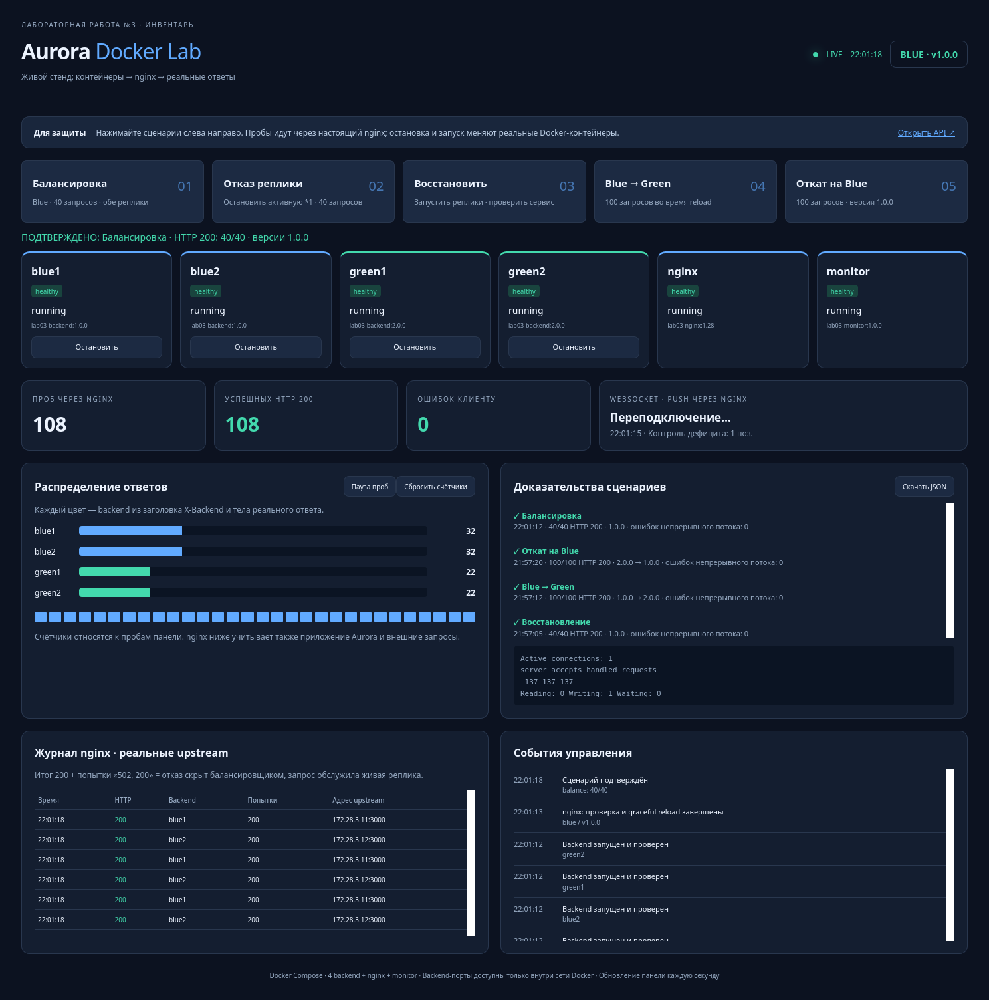
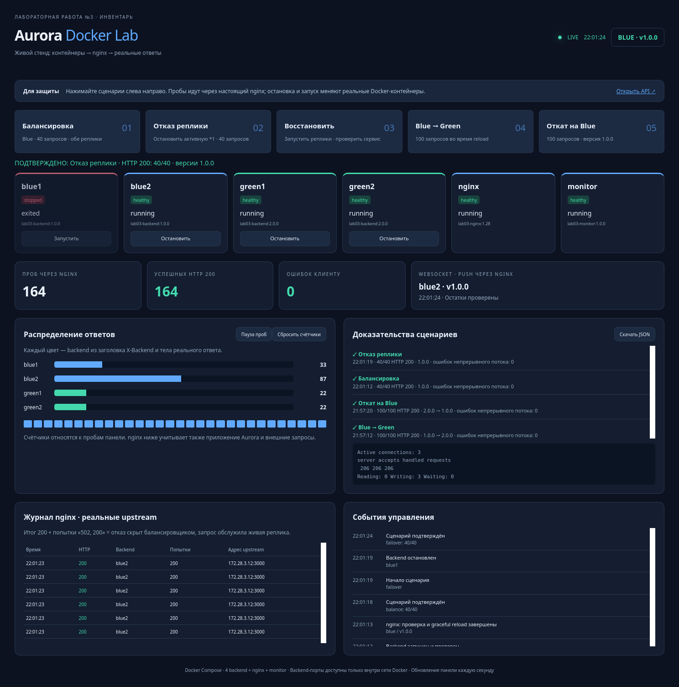
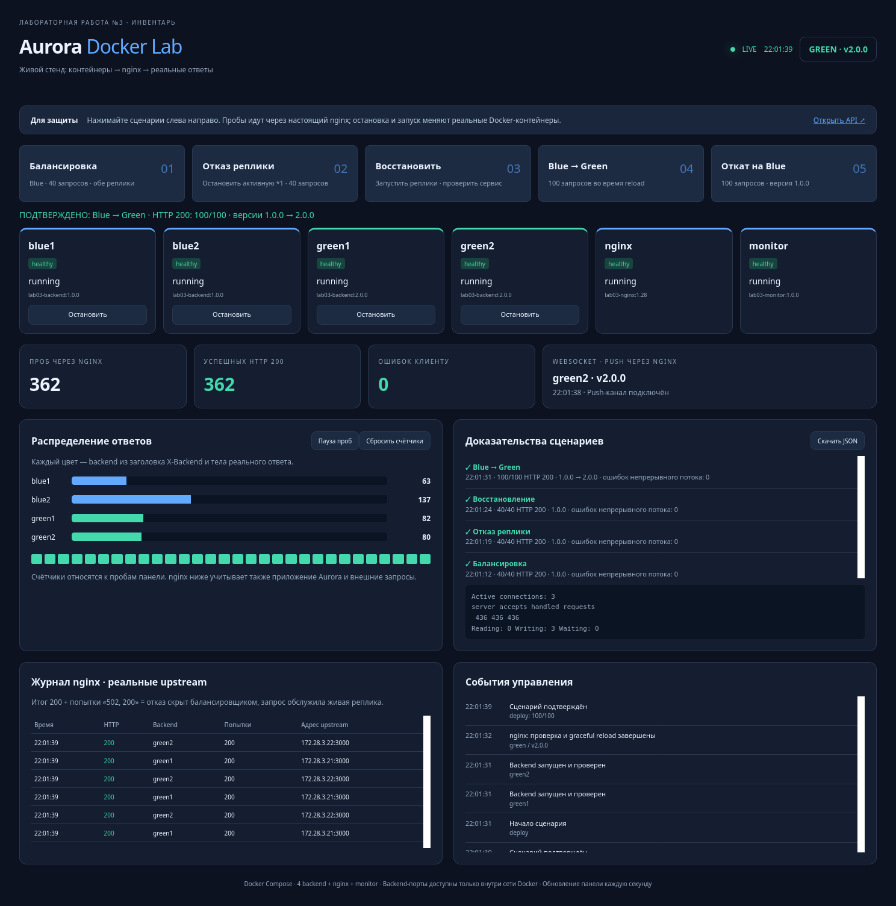
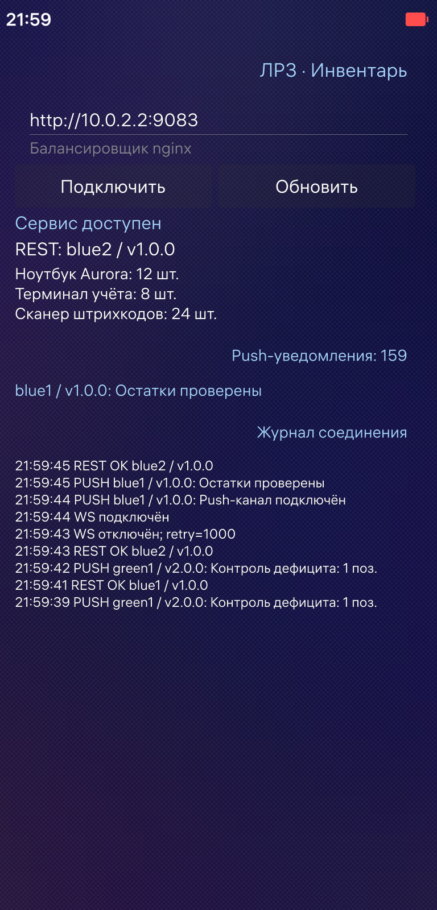
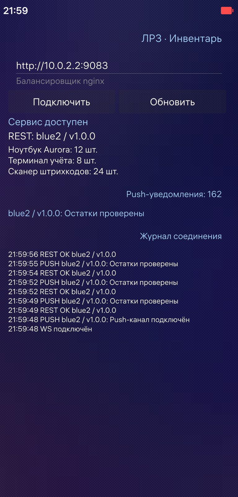
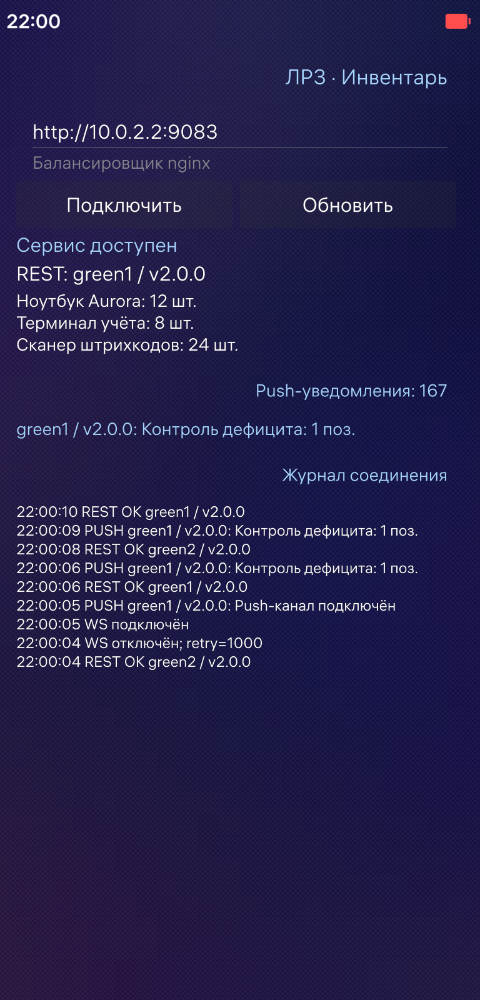
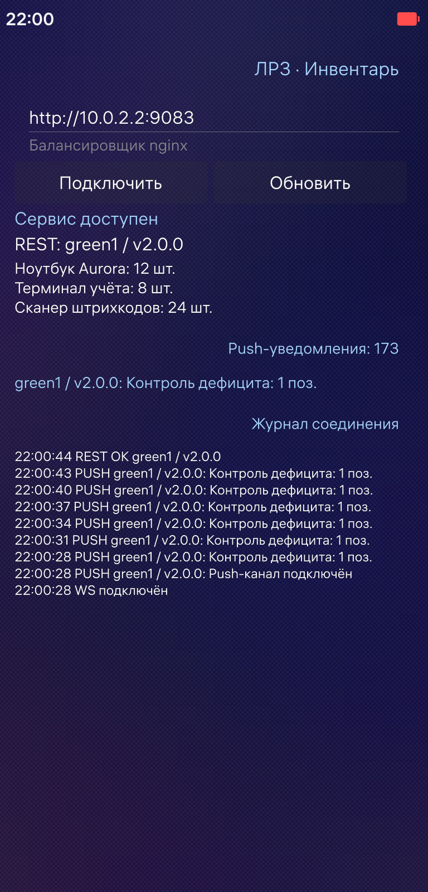

# Лабораторная работа №3

## ВВЕДЕНИЕ

Цель работы — освоить сборку и подпись RPM приложения Aurora OS, контейнерное развёртывание нескольких экземпляров серверного приложения, балансировку нагрузки, обновление blue-green и восстановление соединений нативного клиента при отказах.

Для варианта №7 «Инвентарь» разработал самостоятельный сервис мониторинга каталога, нативный клиент Aurora OS и веб-панель демонстрации. Все серверные компоненты разместил в Docker Compose: четыре backend, nginx и мониторинг. На хосте отдельные процессы сервера и службы лабораторной работы не запускаются. Панель показывает реальные состояния контейнеров, распределение ответов и результаты проверяемых сценариев.

## 1 Постановка задачи и условия выполнения

Работа включает развёртывание нескольких экземпляров приложения, reverse proxy nginx, балансировку, автоматическое восстановление, обновление blue-green и проверку отказоустойчивости. Для мобильной части необходимо собрать и подписать RPM, настроить работу через балансировщик, WebSocket push и повторные попытки соединения.

Мобильные испытания проводились в Oracle VirtualBox VM Aurora OS, вместо физического телефона. Для сборки использован Docker-контейнер Aurora SDK.

В установленном SDK 5.1 отсутствует команда sign_package. Для подписи применён штатный инструмент rpmsign-external и имеющийся тестовый сертификат разработчика SDK.

**Соответствие задачам работы**

| Задача | Реализация |
|---|---|
| Контейнерное развёртывание | Docker Compose, отдельные контейнеры nginx, monitor и четырёх backend |
| Балансировка | Две активные реплики выбранного релиза, round-robin |
| Автовосстановление | restart: unless-stopped, healthcheck контейнеров |
| Обновление | Проверка целевой пары, nginx -t, graceful reload и откат |
| Наблюдаемость | Docker Engine API, пробы REST, JSON access log, nginx stub_status |
| RPM | rpmbuild в Docker-среде Aurora SDK, подпись и проверка |
| Нативный клиент | Qt 5.6/Silica, REST через nginx, WebSocket и backoff |
| Демонстрация | Пять кнопок проверяемых сценариев, экспорт JSON-доказательств |

## 2 Среда и архитектура

### 2.1 Состав стенда

| Компонент | Конфигурация |
|---|---|
| Контейнеризация | Docker Engine, контекст default, Compose, bridge-сеть inventory |
| Backend | Node.js 22 Alpine, только стандартные модули |
| Балансировщик | nginx 1.28 Alpine, опубликованный порт 9083 |
| Панель | Node.js, HTML/CSS/JavaScript, 127.0.0.1:9084 |
| Сборка Aurora | SDK 5.1.1.60-base, Qt 5.6.3, Docker build engine |
| Мобильные испытания | Oracle VirtualBox, AuroraOS-5.1.1.60-base-x86_64 |
| Сеть мобильного клиента | VirtualBox NAT, http://10.0.2.2:9083 |



В Compose создано шесть постоянно работающих контейнеров. Реплики blue1 и blue2 выполняют версию 1.0.0, green1 и green2 — версию 2.0.0. Все backend слушают порт 3000 внутри Docker и не публикуют его на хост. nginx принимает запросы на 9083 и направляет их активной паре. Панель на 9084 выполняет наблюдение и управление. Дополнительный контейнер tests запускается только на время автоматической проверки.

**Роли контейнеров**

| Сервис | Образ и назначение |
|---|---|
| blue1, blue2 | lab03-backend:1.0.0, исходный мониторинг остатков |
| green1, green2 | lab03-backend:2.0.0, контроль дефицита |
| nginx | lab03-nginx:1.28, reverse proxy и балансировка |
| monitor | lab03-monitor:1.0.0, панель, пробы и управление сценариями |

Для версий backend используются разные Docker-образы. Green добавляет признак lowStock для остатка менее 10 и поле lowStockCount в push, сохраняя совместимость с клиентом. Каталог содержит ноутбук Aurora — 12, терминал учёта — 8, сканер штрихкодов — 24: всего 44 единицы и одна дефицитная позиция. Каталог используется только для чтения; конкурирующей записи между репликами нет.

### 2.2 Сеть и постоянные данные

Сервисы размещены в Docker-сети 172.28.3.0/24. Blue имеет постоянные адреса .11/.12, Green — .21/.22. Панель получает адреса через Docker inspect и записывает их в upstream. Это позволяет запускать nginx даже при намеренно остановленной реплике, DNS-имя которой Docker временно не разрешает. Для backend отсутствуют обращения к хосту через host-gateway и отдельные слушающие порты ПК. nginx доступен мобильному клиенту по прежнему адресу 10.0.2.2:9083.

Конфигурация активного upstream хранится в volume routing, журнал nginx — в nginx-logs, история результатов — в evidence. Данные сохраняются после docker compose down и повторного up. Состояния контейнеров и health берутся из Docker Engine API; график распределения строится по заголовку X-Backend фактически полученного ответа.

Панель управления опубликована только на loopback хоста. Для запуска и остановки разрешены четыре backend данного Compose-проекта. Произвольные имена контейнеров не принимаются. Браузерные запросы управления проверяются по Origin.

## 3 Реализация серверной инфраструктуры

### 3.1 REST, push и образы backend

GET /api/health возвращает status, instance, version и время. GET /api/items возвращает каталог и те же метаданные. Заголовки X-Backend и X-App-Version позволяют связать ответ с репликой. Cache-Control: no-store исключает кэширование измерений.

После WebSocket Upgrade сервер отправляет hello, а каждые три секунды — inventory с backend, версией, временем, последовательностью и суммарным остатком. Релиз 2 дополнительно сообщает число дефицитных позиций. Это результат периодической серверной проверки каталога. Sequence локален для экземпляра. Heartbeat ping/pong выполняется каждые пять секунд.

Dockerfile backend основан на node:22-alpine, копирует исходники в образ и запускает Node.js от непривилегированного пользователя node. Аргумент RELEASE определяет модуль релиза. Healthcheck обращается к локальному /api/health. Запуск всех компонентов выполняется одной командой:

```bash
./lab03/lab up -d --build --wait
```

В Compose задано restart: unless-stopped. Контейнеры восстанавливаются после аварии и запуска Docker Engine, если не были намеренно остановлены. Серверный стенд использует native Docker Engine, контекст default. Системная служба docker имеет состояния active и enabled: systemd запускает Docker, а Docker восстанавливает контейнеры. Команда lab фиксирует контекст только для этого проекта. Старые службы lab03-backend@ и lab03-nginx на хосте остановлены и отключены; управление приложениями перенесено в Docker.

### 3.2 Балансировщик nginx

В upstream inventory включаются две реплики выбранного релиза. Используется round-robin, max_fails=1 и fail_timeout=2s. Для сетевых ошибок и ответов 502/503/504 включён proxy_next_upstream, не более двух попыток. Таймаут подключения — одна секунда. Повторы безопасны, поскольку приложение поддерживает чтение.

Для WebSocket передаются Upgrade и Connection, используется HTTP/1.1 и отключена буферизация. Таймаут чтения 12 с превышает интервалы push и heartbeat. REST idle keep-alive отключён, чтобы при смене worker не использовать закрытое простаивающее соединение.

В upstream используются постоянные внутренние адреса из Compose IPAM. Они сохраняются при stop/start и пересоздании контейнеров. Конфигурация nginx не зависит от доступности DNS-имени остановленного backend. После пересоздания всего стенда сохранённый выбор релиза остаётся действительным.

JSON access log содержит итоговый HTTP-статус, адреса upstream, статусы отдельных попыток, backend, версию и время запроса. Пара статусов «502, 200» либо «504, 200» при итоговом 200 доказывает повтор запроса балансировщиком к живой реплике. Конечный клиент при этом получает успешный ответ.

### 3.3 Blue-green и откат

Переключение выполняется мониторингом внутри Docker:

1. Проверить /api/health обоих backend целевого релиза.
2. Записать целевую пару в общий volume routing.
3. Выполнить nginx -t через Docker exec; при ошибке вернуть прежний конфиг.
4. Выполнить nginx -s reload, сохранив контейнер, master и опубликованный порт.
5. Проверить появление ожидаемой версии через nginx.
6. Новые запросы обслуживает целевая пара, старые worker завершаются постепенно.

Если новая версия не появилась, конфигурация возвращается к прежней паре. Неготовая целевая реплика не позволяет начать переключение. Операции управления сериализованы: параллельное изменение конфигурации из двух кнопок отклоняется.

worker_shutdown_timeout=5s ограничивает время старых WebSocket соединений. После их закрытия клиент переподключается. Непрерывность проверяется для REST; сохранение одного WebSocket/TCP соединения при смене релиза не требуется.

## 4 Панель мониторинга и демонстрации

### 4.1 Источники наблюдения

Разработал локальную панель http://localhost:9084. Она объединяет шесть карточек контейнеров, состояния Docker health, активный релиз, счётчики успешных и ошибочных проб, распределение ответов по backend, push-канал, журнал nginx и события управления.

Monitor выполняет около четырёх проб в секунду через настоящий nginx. Каждый ответ сохраняется с временем, HTTP-статусом, backend, версией и задержкой. На уровне генератора автоматического повтора нет: ошибку балансировщика видно в счётчике. Кнопка «Пауза проб» останавливает фоновую нагрузку, а сброс счётчиков позволяет начать новую демонстрацию.

Панель запрашивает nginx stub_status и читает JSON access log. Эти данные включают также запросы Aurora и внешних клиентов. Счётчики собственных проб явно отделены от общего журнала nginx, поэтому их значения не обязаны совпадать.

### 4.2 Проверяемые сценарии

| Кнопка | Выполняемое действие и доказательство |
|---|---|
| Балансировка | Подготовка Blue, 40 запросов, ответы от обеих реплик |
| Отказ реплики | Docker stop активной реплики *1, 40 ответов от *2 |
| Восстановить | Docker start реплик, проверка готовности и 40 запросов |
| Blue → Green | 100 запросов до, во время и после reload, обе версии |
| Откат на Blue | 100 запросов и подтверждение обратного перехода |

Во время сценариев продолжаются фоновые пробы. Успех подтверждается только при отсутствии ошибок как в контрольной серии, так и в непрерывном потоке на её интервале. Для балансировки дополнительно проверяются обе реплики, для отказа — отсутствие ответов остановленного контейнера, для перехода между разными релизами — наличие обеих версий.

История сохраняется в Docker volume evidence. Кнопка «Скачать JSON» выгружает полные результаты: время, каждую пробу, распределение, ошибки и выдержку из nginx. Это позволяет показать доказательство независимо от текущих значений графика.







Для воспроизведения защиты подготовил DEMO.md: запуск стенда, демонстрация обеих реплик, остановка контейнера, восстановление, обновление и откат. При необходимости те же состояния проверяются стандартными docker compose ps, docker logs и docker stats.

## 5 Нативное приложение Aurora OS

### 5.1 Сетевой клиент

DeployClient предоставляет QML адрес, состояние сервиса, backend и версию, каталог, последний push, счётчик уведомлений и журнал. Адрес сохраняется в QSettings. Интерфейс содержит поле балансировщика и кнопки подключения и обновления.

QNetworkAccessManager запрашивает /api/items с собственным QTimer на три секунды. Одновременно выполняется один запрос. После успеха следующая проверка идёт через две секунды; при ошибках задержка увеличивается до 16 секунд и сбрасывается после восстановления. При смене URL устаревший ответ отбрасывается по номеру поколения.

QWebSocket переподключается через 1, 2, 4, 8 и 16 секунд. Watchdog проверяет отсутствие сообщений более 10 секунд. При недоступности обеих активных реплик последний каталог остаётся видимым, статус сообщает об ошибке и следующей попытке.

### 5.2 Сборка, подпись и установка

RPM собран для AuroraOS-5.1.1.60-base-x86_64. Команда sfdk build запускает rpmbuild, qmake и make в Docker-контейнере Aurora SDK. В spec заданы зависимости Qt5Core, Qt5Qml, Qt5Quick, Qt5Network, Qt5WebSockets и auroraapp.

```bash
# Рабочий каталог: lab03/aurora-app
~/AuroraOS/bin/sfdk -c target=AuroraOS-5.1.1.60-base-x86_64 build
python3 ../infra/sign-rpm.py
```

Получен пакет ru.mai.auroradeploy-1.0.0-1.x86_64.rpm. Сценарий подписи использует regular_cert.pem и regular_key.pem установленного SDK, выполняет sign/verify/dump внутри сборочного движка и удаляет временный ключ. Сертификат принадлежит developer/regular, имеет имя Noname developer (for testing only, do not use for production).

```text
Signatures successfully verified for "/home/bogdan/MAI/AURORA-SDK-PROJECTS/mobile-web/lab03/aurora-app/RPMS/ru.mai.auroradeploy-1.0.0-1.x86_64.rpm"
Subject: Noname developer (for testing only, do not use for production)
Group: developer
Subgroup: regular
Key ID: 1d8521d0b43315e104e30ed29c4a668343d6b3421438e21a3275139644b61e10
Signature: xS6RGNtMx9nmr6MZ2qkzZ77oaJYrbxt8QrHEUVmPAAlvYAMZBavG/o5Wow+y7MCh0YELFO2nialfwYYcFEL/IA==
```

Подписанный пакет установлен в VirtualBox штатным pkcon install-local. Журнал установки:

```text
Transaction:	Installing files
Status: 	Waiting in queue
Status: 	Waiting for authentication
Status: 	Waiting in queue
Status: 	Starting
Status: 	Resolving dependencies
Percentage:	0
Percentage:	100
Status: 	Installing packages
Percentage:	0
Status: 	Downloading packages
Package:	ru.mai.auroradeploy-1.0.0-1.x86_64
Percentage:	100
Status: 	Installing packages
Status: 	Finished
Results:
Downloaded   ru.mai.auroradeploy-1.0.0-1.x86_64 (PK_TMP_DIR)
Installed    ru.mai.auroradeploy-1.0.0-1.x86_64 (PK_TMP_DIR)
ru.mai.auroradeploy-1.0.0-1.x86_64
```

## 6 Экспериментальная проверка

### 6.1 Контейнерные проверки

Тест infrastructure-test.js запускается отдельным контейнером tests и обращается к API панели и настоящему nginx. Проверены пять сценариев, состояние остановленного контейнера, новый lowStock, отклонение нездорового Green, ограничения управления, JSON access log и stub_status.

```bash
./lab03/lab run --rm tests
```

```text
 Image node:22-alpine Pulling 
 Image node:22-alpine Pulled 
 Container lab03-tests-run-caa1872c3f14 Creating 
 Container lab03-tests-run-caa1872c3f14 Created 
PASS balance 40/40 распределение={"blue1":18,"blue2":22,"green1":0,"green2":0} версии=1.0.0
PASS failover 40/40 распределение={"blue1":0,"blue2":40,"green1":0,"green2":0} версии=1.0.0
PASS recover 40/40 распределение={"blue1":22,"blue2":18,"green1":0,"green2":0} версии=1.0.0
PASS deploy 100/100 распределение={"blue1":6,"blue2":6,"green1":37,"green2":51} версии=1.0.0,2.0.0
PASS rollback 100/100 распределение={"blue1":48,"blue2":40,"green1":5,"green2":7} версии=2.0.0,1.0.0
PASS повторный откат на уже активный релиз не выдаётся за обновление
PASS нездоровый green отклонён, blue продолжает работать
PASS ограничения управления контейнерами и Origin
PASS Docker API, 6 контейнеров, настоящий журнал nginx и stub_status
ИТОГО: Docker-сценарии и проверки пройдены
```

В контрольной серии отказа все 40 ответов получены от второй реплики. Во время обновления и отката успешны все 100 запросов. Распределение отдельной серии между двумя живыми репликами не обязано быть строго равным: одновременно работают фоновые пробы и мобильный клиент.

WebSocket проверен внутри Docker на обоих релизах. Проверяются hello, inventory, total=44, версия и lowStockCount=1 для Green. Соединение удерживается 11,5 с, более двух периодов heartbeat. Также проверены HTTP 405 и 404.

```text
 Container lab03-tests-run-9a2efd7834aa Creating 
 Container lab03-tests-run-9a2efd7834aa Created 
PASS WebSocket hello, push, ping/pong > 10 с; HTTP 405/404; версия 1.0.0
```

```text
 Container lab03-tests-run-5b525cd37253 Creating 
 Container lab03-tests-run-5b525cd37253 Created 
PASS WebSocket hello, push, ping/pong > 10 с; HTTP 405/404; версия 2.0.0
```

### 6.2 Проверка интерфейса Firefox и перезапуска стенда

Сценарий browser-demo.js открывает настоящую страницу в Firefox, нажимает пять кнопок, дожидается результата в интерфейсе, сверяет JSON-доказательства и сохраняет снимки. Проверены шесть карточек и получение push через nginx.

```text
PASS панель: 6 контейнеров, WebSocket подключён, nginx отвечает
PASS кнопка balance 40/40
PASS кнопка failover 40/40
PASS кнопка recover 40/40
PASS кнопка deploy 100/100
PASS кнопка rollback 100/100
ИТОГО: 5 кнопок проверены в Firefox; снимки сохранены
```

Дополнительно выполнены docker compose down и повторный up --wait без удаления volumes. После пересоздания nginx продолжил обслуживать сохранённый Green-релиз, а история сценариев осталась доступна. Старые systemd-службы ЛР3 отключены, backend-порты 9311/9312/9321/9322 на хосте больше не слушаются.

### 6.3 Испытания приложения в VirtualBox

Сценарий emulator-demo.py выполняет пять этапов с одним работающим GUI-процессом. В каждом этапе проверяется, что PID не изменился. Начальный этап подтверждает REST и push от Blue.



Для отказа выбирается именно backend действующего push-соединения. Контейнер останавливается через Docker API, а клиент автоматически подключается к оставшейся реплике. REST ERROR при отказе одной реплики отсутствует.

```text
[I] DeployClient::record:54 - 21:59:47 WS отключён; retry=1000
[I] DeployClient::record:54 - 21:59:48 WS подключён
[I] DeployClient::record:54 - 21:59:48 PUSH blue2 / v1.0.0: Push-канал подключён
[I] DeployClient::record:54 - 21:59:49 REST OK blue2 / v1.0.0
[I] DeployClient::record:54 - 21:59:49 PUSH blue2 / v1.0.0: Остатки проверены
[I] DeployClient::record:54 - 21:59:52 REST OK blue2 / v1.0.0
[I] DeployClient::record:54 - 21:59:52 PUSH blue2 / v1.0.0: Остатки проверены
[I] DeployClient::record:54 - 21:59:54 REST OK blue2 / v1.0.0
[I] DeployClient::record:54 - 21:59:55 PUSH blue2 / v1.0.0: Остатки проверены
[I] DeployClient::record:54 - 21:59:56 REST OK blue2 / v1.0.0
```



После восстановления реплики выполнен переход на Green. REST получает версию 2.0.0, затем push-канал переподключается и передаёт сообщение «Контроль дефицита: 1 поз.». Приложение и его URL не меняются.

```text
[I] DeployClient::record:54 - 22:00:00 REST OK green2 / v2.0.0
[I] DeployClient::record:54 - 22:00:01 PUSH blue2 / v1.0.0: Остатки проверены
[I] DeployClient::record:54 - 22:00:02 REST OK green1 / v2.0.0
[I] DeployClient::record:54 - 22:00:04 PUSH blue2 / v1.0.0: Остатки проверены
[I] DeployClient::record:54 - 22:00:04 REST OK green2 / v2.0.0
[I] DeployClient::record:54 - 22:00:04 WS отключён; retry=1000
[I] DeployClient::record:54 - 22:00:05 WS подключён
[I] DeployClient::record:54 - 22:00:05 PUSH green1 / v2.0.0: Push-канал подключён
[I] DeployClient::record:54 - 22:00:06 REST OK green1 / v2.0.0
[I] DeployClient::record:54 - 22:00:06 PUSH green1 / v2.0.0: Контроль дефицита: 1 поз.
[I] DeployClient::record:54 - 22:00:08 REST OK green2 / v2.0.0
[I] DeployClient::record:54 - 22:00:09 PUSH green1 / v2.0.0: Контроль дефицита: 1 поз.
[I] DeployClient::record:54 - 22:00:10 REST OK green1 / v2.0.0
```



Дополнительно остановлены обе активные Green-реплики. В этом случае новые данные недоступны: клиент показывает ошибку, сохраняет каталог и увеличивает задержки повторов. После запуска контейнеров REST и push возобновляются автоматически.

```text
[I] DeployClient::record:54 - 22:00:11 WS отключён; retry=1000
[I] DeployClient::record:54 - 22:00:13 WS отключён; retry=2000
[I] DeployClient::record:54 - 22:00:13 REST ERROR Error transferring http://10.0.2.2:9083/api/items - server replied: Bad Gateway; retry=2000
[I] DeployClient::record:54 - 22:00:15 WS отключён; retry=4000
[I] DeployClient::record:54 - 22:00:15 REST ERROR Error transferring http://10.0.2.2:9083/api/items - server replied: Bad Gateway; retry=4000
[I] DeployClient::record:54 - 22:00:19 WS отключён; retry=8000
[I] DeployClient::record:54 - 22:00:19 REST ERROR Error transferring http://10.0.2.2:9083/api/items - server replied: Bad Gateway; retry=8000
```

```text
[I] DeployClient::record:54 - 22:00:28 REST ERROR Error transferring http://10.0.2.2:9083/api/items - server replied: Bad Gateway; retry=16000
[I] DeployClient::record:54 - 22:00:28 WS подключён
[I] DeployClient::record:54 - 22:00:28 PUSH green1 / v2.0.0: Push-канал подключён
[I] DeployClient::record:54 - 22:00:28 PUSH green1 / v2.0.0: Контроль дефицита: 1 поз.
[I] DeployClient::record:54 - 22:00:31 PUSH green1 / v2.0.0: Контроль дефицита: 1 поз.
[I] DeployClient::record:54 - 22:00:34 PUSH green1 / v2.0.0: Контроль дефицита: 1 поз.
[I] DeployClient::record:54 - 22:00:37 PUSH green1 / v2.0.0: Контроль дефицита: 1 поз.
[I] DeployClient::record:54 - 22:00:40 PUSH green1 / v2.0.0: Контроль дефицита: 1 поз.
[I] DeployClient::record:54 - 22:00:43 PUSH green1 / v2.0.0: Контроль дефицита: 1 поз.
[I] DeployClient::record:54 - 22:00:44 REST OK green1 / v2.0.0
```



Общий журнал мобильного сценария:

```text
{"ok":true,"colour":"green"}
{"ok":true,"colour":"green"}
{"ok":true,"colour":"green"}
{"ok":true,"colour":"green"}
{"ok":true,"colour":"blue"}
PASS 01-blue-push PID=977
{"ok":true,"colour":"blue"}
PASS 02-backend-failure PID=977
{"ok":true,"colour":"blue"}
{"ok":true,"colour":"green"}
PASS 03-blue-green PID=977
{"ok":true,"colour":"green"}
{"ok":true,"colour":"green"}
PASS 04-total-outage PID=977
{"ok":true,"colour":"green"}
{"ok":true,"colour":"green"}
PASS 05-recovered PID=977
ИТОГО: 5 этапов пройдены; GUI PID не изменился
{"ok":true,"colour":"green"}
{"ok":true,"colour":"green"}
{"ok":true,"colour":"green"}
{"ok":true,"colour":"green"}
```

### 6.4 Сводка результатов

| Проверка | Результат |
|---|---|
| Балансировка | 40/40, обе реплики Blue |
| Отказ контейнера | 40/40 через оставшуюся реплику |
| Восстановление | 40/40, обе реплики снова доступны |
| Blue-green | 100/100, версии 1.0.0 и 2.0.0 |
| Откат | 100/100, возврат на 1.0.0 |
| Нездоровый target | Переключение отклонено, прежняя пара отвечает |
| Интерфейс Firefox | Проверены все пять кнопок и push |
| Пересоздание Compose | Сохранены релиз и доказательства в volumes |
| Подпись RPM | Signatures successfully verified |
| Aurora | Отказ, обновление и восстановление без перезапуска GUI |

## ЗАКЛЮЧЕНИЕ

Разработал контейнерный стенд мониторинга инвентаря и нативный клиент Aurora OS. Все серверные сервисы разместил в Docker Compose. Настроил nginx, две пары релизов, healthcheck и restart policy. Для наблюдения реализовал панель с реальными данными Docker и nginx, генератором запросов и экспортом доказательств.

Проверил продолжение обслуживания при отказе одной реплики, обновление и откат без ошибок контрольной серии, получение push и автоматическое восстановление мобильного клиента. Подписанный RPM собран и установлен в эмуляторе Aurora OS. Для защиты подготовил воспроизводимый сценарий с пятью кнопками и снимками фактических результатов.

В локальном стенде применяется HTTP/WS. Каталог неизменяемый; доставка push не является долговечной очередью. Гарантия наблюдаемой непрерывности относится к REST; при завершении старого worker WebSocket переподключается. Эти особенности учтены в проверках и демонстрации.

## СПИСОК ИСПОЛЬЗОВАННЫХ ИСТОЧНИКОВ

1. Задание лабораторной работы №3. Файл lab03/TASK.md.
2. Материалы лабораторных работ №1–2. Каталоги lab01 и lab02.
3. Aurora SDK 5.1.1.60. Справка sfdk --help-building и rpmsign-external.
4. Docker Compose. Документация services, networks и volumes: https://docs.docker.com/compose/.
5. Docker Engine API. Управление контейнерами, inspect и exec: https://docs.docker.com/reference/api/engine/.
6. nginx. ngx_http_proxy_module и stub_status: https://nginx.org/en/docs/.
7. Fette I., Melnikov A. The WebSocket Protocol. RFC 6455, 2011.


## ПРИЛОЖЕНИЕ А. Полные листинги

Приведены все авторские файлы сервиса, клиента, развёртывания и испытаний. Генерируемые файлы сборки и сторонние библиотеки не включены.

### Сервер

**server/Dockerfile**

```text
FROM node:22-alpine
ARG RELEASE=1
ENV RELEASE=${RELEASE} PORT=3000
WORKDIR /app
COPY --chown=node:node *.js catalog.json package.json ./
USER node
EXPOSE 3000
HEALTHCHECK --interval=3s --timeout=2s --start-period=3s --retries=3 CMD node -e "fetch('http://127.0.0.1:3000/api/health').then(r=>{if(!r.ok)process.exit(1)}).catch(()=>process.exit(1))"
CMD ["node", "server.js"]
```

**server/package.json**

```text
{
  "name": "lab03-inventory-monitor",
  "version": "1.0.0",
  "private": true,
  "scripts": { "start": "node server.js", "test": "node ../tests/infrastructure-test.js" }
}
```

**server/catalog.json**

```text
[
  {"id": 1, "name": "Ноутбук Aurora", "quantity": 12},
  {"id": 2, "name": "Терминал учёта", "quantity": 8},
  {"id": 3, "name": "Сканер штрихкодов", "quantity": 24}
]
```

**server/server.js**

```text
'use strict';
// Самостоятельный сервис мониторинга инвентаря; только стандартные модули.
const http = require('node:http');
const fs = require('node:fs');
const path = require('node:path');
const { WebSocketServer } = require('./websocket');
const instance = process.env.INSTANCE || 'blue1';
const release = require(process.env.RELEASE === '2' ? './release-v2' : './release-v1');
const version = release.version;
const port = Number(process.env.PORT || 9311);
let sequence = 0;
const catalog = () => release.items(JSON.parse(fs.readFileSync(path.join(__dirname, 'catalog.json'), 'utf8')));
const metadata = () => ({ instance, version, time: new Date().toISOString() });
const server = http.createServer((req, res) => {
  const url = new URL(req.url, 'http://localhost');
  res.setHeader('Content-Type', 'application/json; charset=utf-8');
  res.setHeader('Cache-Control', 'no-store');
  res.setHeader('X-Backend', instance);
  res.setHeader('X-App-Version', version);
  if (req.method !== 'GET') {
    res.writeHead(405, { Allow: 'GET' });
    return res.end(JSON.stringify({ error: 'Сервис мониторинга поддерживает только чтение' }));
  }
  if (url.pathname === '/api/health') return res.end(JSON.stringify({ ...metadata(), status: 'ok' }));
  if (url.pathname === '/api/items') return res.end(JSON.stringify({ ...metadata(), items: catalog() }));
  res.writeHead(404);
  res.end(JSON.stringify({ error: 'Ресурс не найден' }));
});
const ws = new WebSocketServer(server, { path: '/ws' });
ws.on('connection', conn => {
  conn.sendJson({ type: 'hello', ...metadata(), message: 'Push-канал подключён' });
  console.log(JSON.stringify({ event: 'ws-connected', ...metadata() }));
});
const timer = setInterval(() => {
  // Каждый backend сам публикует наблюдение общего неизменяемого каталога.
  ws.broadcast({ type: 'inventory', ...metadata(), sequence: ++sequence,
    ...release.notification(catalog()), total: catalog().reduce((n, item) => n + item.quantity, 0) });
}, 3000);
server.listen(port, '0.0.0.0', () => console.log(JSON.stringify({ event: 'listen', port, ...metadata() })));
process.on('SIGTERM', () => {
  clearInterval(timer);
  ws.close();
  server.close(() => process.exit(0));
  setTimeout(() => process.exit(0), 3000).unref();
});
```

**server/release-v1.js**

```text
'use strict';
module.exports = {
  version: '1.0.0',
  items: rows => rows,
  notification: () => ({ message: 'Остатки проверены' }),
};
```

**server/release-v2.js**

```text
'use strict';
// Новая обратно совместимая версия: контроль дефицита (остаток менее 10).
module.exports = {
  version: '2.0.0',
  items: rows => rows.map(row => ({ ...row, lowStock: row.quantity < 10 })),
  notification: rows => ({ message: 'Контроль дефицита: ' + rows.filter(row => row.lowStock).length + ' поз.',
    lowStockCount: rows.filter(row => row.lowStock).length }),
};
```

**server/websocket.js**

```text
'use strict';
// Однонаправленный push RFC 6455: text, ping/pong, close; без расширений.
const { createHash } = require('node:crypto');
const { EventEmitter } = require('node:events');
function frame(opcode, text) {
  const data = Buffer.from(text);
  if (data.length > 65535) throw new Error('Слишком длинный push');
  const header = Buffer.alloc(data.length < 126 ? 2 : 4);
  header[0] = 0x80 | opcode;
  header[1] = data.length < 126 ? data.length : 126;
  if (header.length === 4) header.writeUInt16BE(data.length, 2);
  return Buffer.concat([header, data]);
}
class WebSocketServer extends EventEmitter {
  constructor(server, { path }) {
    super();
    this.clients = new Set();
    server.on('upgrade', (req, socket, head) => {
      const key = req.headers['sec-websocket-key'] || '';
      if (req.url !== path || req.method !== 'GET' ||
          req.headers['sec-websocket-version'] !== '13' ||
          !/^[A-Za-z0-9+/]{22}==$/.test(key)) {
        socket.end('HTTP/1.1 400 Bad Request\r\nConnection: close\r\nContent-Length: 0\r\n\r\n');
        return;
      }
      const accept = createHash('sha1').update(key + '258EAFA5-E914-47DA-95CA-C5AB0DC85B11').digest('base64');
      socket.write('HTTP/1.1 101 Switching Protocols\r\nUpgrade: websocket\r\nConnection: Upgrade\r\n' +
        `Sec-WebSocket-Accept: ${accept}\r\n\r\n`);
      const client = { socket, alive: true, sendJson: obj => socket.write(frame(1, JSON.stringify(obj))) };
      this.clients.add(client);
      let buffer = Buffer.alloc(0);
      const consume = chunk => {
        buffer = Buffer.concat([buffer, chunk]);
        while (buffer.length >= 2) {
          const opcode = buffer[0] & 15;
          const size = buffer[1] & 127;
          // Клиенту разрешены только короткие маскированные служебные кадры.
          if ((buffer[0] & 0xf0) !== 0x80 || !(buffer[1] & 128) ||
              size > 125 || ![8, 9, 10].includes(opcode)) {
            socket.end(frame(8, Buffer.from([3, 235]))); // 1003
            return;
          }
          if (buffer.length < 6 + size) return;
          const payload = Buffer.from(buffer.subarray(6, 6 + size));
          for (let i = 0; i < size; i++) payload[i] ^= buffer[2 + i % 4];
          buffer = buffer.subarray(6 + size);
          if (opcode === 8) { socket.end(frame(8, payload)); return; }
          if (opcode === 9) socket.write(frame(10, payload));
          if (opcode === 10) client.alive = true;
        }
      };
      socket.on('data', consume);
      socket.on('error', () => socket.destroy());
      socket.on('close', () => this.clients.delete(client));
      this.emit('connection', client);
      if (head.length) consume(head);
    });
    this.heartbeat = setInterval(() => {
      for (const client of this.clients) {
        if (!client.alive) client.socket.destroy();
        else { client.alive = false; client.socket.write(frame(9, '')); }
      }
    }, 5000);
  }
  broadcast(value) {
    for (const client of this.clients) client.sendJson(value);
  }
  close() {
    clearInterval(this.heartbeat);
    for (const client of this.clients) client.socket.end(frame(8, Buffer.from([3, 233])));
  }
}
module.exports = { WebSocketServer };
```

### Инфраструктура

**lab**

```text
#!/usr/bin/env bash
# Только данный Compose-проект использует native Docker Engine.
set -euo pipefail
ROOT="$(dirname "$(readlink -f "$0")")"
exec docker --context default compose -f "$ROOT/compose.yaml" "$@"
```

**compose.yaml**

```text
name: lab03
x-backend: &backend
  restart: unless-stopped
  init: true
  networks: [inventory]
  logging:
    driver: json-file
    options: {max-size: "5m", max-file: "2"}
services:
  blue1:
    <<: *backend
    image: lab03-backend:1.0.0
    build: {context: ./server, args: {RELEASE: "1"}}
    environment: {INSTANCE: blue1}
    networks:
      inventory: {ipv4_address: 172.28.3.11}
  blue2:
    <<: *backend
    image: lab03-backend:1.0.0
    pull_policy: never
    environment: {INSTANCE: blue2}
    networks:
      inventory: {ipv4_address: 172.28.3.12}
    depends_on: [blue1]
  green1:
    <<: *backend
    image: lab03-backend:2.0.0
    build: {context: ./server, args: {RELEASE: "2"}}
    environment: {INSTANCE: green1}
    networks:
      inventory: {ipv4_address: 172.28.3.21}
  green2:
    <<: *backend
    image: lab03-backend:2.0.0
    pull_policy: never
    environment: {INSTANCE: green2}
    networks:
      inventory: {ipv4_address: 172.28.3.22}
    depends_on: [green1]
  nginx:
    build: ./infra/nginx
    image: lab03-nginx:1.28
    restart: unless-stopped
    ports: ["9083:9083"]
    networks: [inventory]
    volumes:
      - routing:/etc/nginx/routing
      - nginx-logs:/var/log/lab03
    depends_on:
      blue1: {condition: service_healthy}
      blue2: {condition: service_healthy}
      green1: {condition: service_healthy}
      green2: {condition: service_healthy}
    healthcheck:
      test: ["CMD", "wget", "-q", "-O", "/dev/null", "http://127.0.0.1:9083/nginx_status"]
      interval: 3s
      timeout: 2s
      retries: 3
  monitor:
    build: ./monitor
    image: lab03-monitor:1.0.0
    restart: unless-stopped
    init: true
    ports: ["127.0.0.1:9084:9084"]
    networks: [inventory]
    volumes:
      - /var/run/docker.sock:/var/run/docker.sock
      - routing:/etc/nginx/routing
      - nginx-logs:/var/log/lab03:ro
      - evidence:/evidence
    depends_on: {nginx: {condition: service_healthy}}
    healthcheck:
      test: ["CMD", "node", "-e", "fetch('http://127.0.0.1:9084/api/live').then(r=>{if(!r.ok)process.exit(1)}).catch(()=>process.exit(1))"]
      interval: 3s
      timeout: 2s
      retries: 3
  tests:
    image: node:22-alpine
    profiles: [test]
    working_dir: /tests
    volumes: ["./tests:/tests:ro"]
    environment:
      BASE_URL: http://nginx:9083
      MONITOR_URL: http://monitor:9084
    networks: [inventory]
    command: ["node", "infrastructure-test.js"]
networks:
  inventory:
    ipam:
      config: [{subnet: 172.28.3.0/24}]
volumes:
  routing:
  nginx-logs:
  evidence:
```

**infra/nginx/Dockerfile**

```text
FROM nginx:1.28-alpine
COPY nginx.conf /etc/nginx/nginx.conf
COPY routing/ /etc/nginx/routing/
RUN mkdir -p /var/log/lab03
```

**infra/nginx/nginx.conf**

```text
worker_processes 1;
worker_shutdown_timeout 5s;
error_log /var/log/lab03/error.log notice;
events { worker_connections 1024; }
http {
    keepalive_timeout 0;
    log_format evidence escape=json '{"time":"$time_iso8601","status":$status,"method":"$request_method","path":"$uri","upstream":"$upstream_addr","attempts":"$upstream_status","backend":"$upstream_http_x_backend","version":"$upstream_http_x_app_version","seconds":$request_time}';
    access_log /var/log/lab03/access.log evidence;
    map $http_upgrade $connection_upgrade { default upgrade; '' close; }
    upstream inventory {
        include /etc/nginx/routing/active.conf;
    }
    server {
        listen 9083;
        location = /nginx_status {
            stub_status;
            access_log off;
        }
        location / {
            proxy_pass http://inventory;
            proxy_http_version 1.1;
            proxy_set_header Host $host;
            proxy_set_header Upgrade $http_upgrade;
            proxy_set_header Connection $connection_upgrade;
            proxy_connect_timeout 1s;
            proxy_read_timeout 12s;
            proxy_next_upstream error timeout http_502 http_503 http_504;
            proxy_next_upstream_tries 2;
            proxy_buffering off;
        }
    }
}
```

**infra/nginx/routing/active.conf**

```text
server 172.28.3.11:3000 max_fails=1 fail_timeout=2s;
server 172.28.3.12:3000 max_fails=1 fail_timeout=2s;
```

**infra/nginx/routing/colour**

```text
blue
```

**infra/control.py**

```text
#!/usr/bin/env python3
"""Короткий CLI Docker Compose; серверных процессов на хосте не создаёт."""
import argparse
import json
from pathlib import Path
import subprocess
import urllib.error
import urllib.request

ROOT = Path(__file__).resolve().parents[1]

def compose(*args):
    subprocess.run(['docker', '--context', 'default', 'compose', '-f', str(ROOT / 'compose.yaml'), *args], check=True)

def action(name, target):
    payload = json.dumps({'action': name, 'target': target}).encode()
    req = urllib.request.Request('http://127.0.0.1:9084/api/action', data=payload,
                                 headers={'Content-Type': 'application/json'})
    try:
        with urllib.request.urlopen(req, timeout=45) as reply:
            print(reply.read().decode())
    except urllib.error.HTTPError as error:
        raise SystemExit(error.read().decode())

if __name__ == '__main__':
    parser = argparse.ArgumentParser()
    parser.add_argument('action', choices=['install', 'up', 'down', 'switch', 'start', 'stop', 'status', 'logs', 'test'])
    parser.add_argument('target', nargs='?')
    args = parser.parse_args()
    if args.action in ('install', 'up'):
        compose('up', '-d', '--build', '--wait')
    elif args.action == 'status':
        compose('ps', '-a')
    elif args.action == 'down':
        compose('down')
    elif args.action == 'logs':
        compose('logs', '--tail', '100', *([args.target] if args.target else []))
    elif args.action == 'test':
        compose('run', '--rm', 'tests')
    else:
        action(args.action, args.target)
```

**infra/sign-rpm.py**

```text
#!/usr/bin/env python3
"""Подпись штатным rpmsign-external из SDK 5.1, проверка до установки."""
from pathlib import Path
import shlex
import subprocess
import sys

root = Path(__file__).resolve().parents[1]
rpm = Path(sys.argv[1]).resolve() if len(sys.argv) > 1 else root / 'aurora-app/RPMS/ru.mai.auroradeploy-1.0.0-1.x86_64.rpm'
certs = Path.home() / 'AuroraOS/package-signing'
remote = subprocess.check_output(['ssh', 'aurora-build', 'mktemp -d /tmp/lab03-sign.XXXXXX'], text=True).strip()
try:
    subprocess.run(['scp', str(certs / 'regular_key.pem'), str(certs / 'regular_cert.pem'),
                    'aurora-build:' + remote + '/'], check=True)
    key, cert, package = map(shlex.quote, [remote + '/regular_key.pem', remote + '/regular_cert.pem', str(rpm)])
    command = (f'chmod 600 {key} && rpmsign-external sign -k {key} -c {cert} {package}'
               f' && rpmsign-external verify {package} && rpmsign-external dump {package}')
    subprocess.run(['ssh', 'aurora-build', command], check=True)
finally:
    subprocess.run(['ssh', 'aurora-build', 'rm -rf -- ' + shlex.quote(remote)], check=True)
```

### Панель мониторинга

**monitor/Dockerfile**

```text
FROM node:22-alpine
WORKDIR /app
COPY *.js ./
COPY public/ ./public/
EXPOSE 9084
CMD ["node", "server.js"]
```

**monitor/server.js**

```text
'use strict';
// Локальная панель стенда: Docker Engine API, реальные пробы nginx, доказательства.
const http = require('node:http');
const fs = require('node:fs');
const path = require('node:path');
const BACKENDS = ['blue1', 'blue2', 'green1', 'green2'];
const sleep = ms => new Promise(resolve => setTimeout(resolve, ms));
const routing = '/etc/nginx/routing';
const events = [], samples = [];
let serial = 0, busy = '', probing = true, lastDocker = [], dockerError = '', inspecting = false;
let proofs = [];
try { proofs = JSON.parse(fs.readFileSync('/evidence/scenarios.json', 'utf8')); } catch {}
const colour = () => fs.readFileSync(path.join(routing, 'colour'), 'utf8').trim();
function event(message, detail = '') {
  const item = { time: new Date().toISOString(), message, detail };
  events.unshift(item);
  events.splice(80);
  console.log(JSON.stringify(item));
}
function docker(method, resource, body) {
  return new Promise((resolve, reject) => {
    const data = body === undefined ? undefined : JSON.stringify(body);
    const req = http.request({ socketPath: '/var/run/docker.sock', path: '/v1.47' + resource,
      signal: AbortSignal.timeout(15000),
      method, headers: data ? { 'Content-Type': 'application/json', 'Content-Length': Buffer.byteLength(data) } : {} }, res => {
      const chunks = [];
      res.on('data', part => chunks.push(part));
      res.on('end', () => {
        const text = Buffer.concat(chunks).toString();
        if (res.statusCode >= 300) return reject(new Error(`Docker ${res.statusCode}: ${text}`));
        if (!text) return resolve(null);
        try { resolve(JSON.parse(text)); } catch { resolve(text); }
      });
    });
    req.setTimeout(15000, () => req.destroy(new Error('Docker timeout')));
    req.on('error', reject);
    req.end(data);
  });
}
async function containers() {
  const filter = encodeURIComponent(JSON.stringify({ label: ['com.docker.compose.project=lab03'] }));
  return docker('GET', '/containers/json?all=1&filters=' + filter);
}
async function container(service) {
  const item = (await containers()).find(c => c.Labels['com.docker.compose.service'] === service);
  if (!item) throw new Error('Контейнер не найден: ' + service);
  return item;
}
async function refreshDocker() {
  if (inspecting) return;
  inspecting = true;
  try {
    lastDocker = await Promise.all((await containers()).filter(c => c.Labels['com.docker.compose.service'] !== 'tests').map(async c => {
      const detail = await docker('GET', `/containers/${c.Id}/json`);
      return { id: c.Id.slice(0, 12), name: c.Labels['com.docker.compose.service'], image: detail.Config.Image,
        state: detail.State.Status, status: c.Status, restarts: detail.RestartCount,
        health: detail.State.Status === 'running' ? detail.State.Health?.Status || 'running' : 'stopped' };
    }));
    dockerError = '';
  } catch (error) { dockerError = error.message; }
  finally { inspecting = false; }
}
async function execNginx(args) {
  const nginx = await container('nginx');
  const exec = await docker('POST', `/containers/${nginx.Id}/exec`, {
    Cmd: ['nginx', ...args], AttachStdout: true, AttachStderr: true });
  await docker('POST', `/exec/${exec.Id}/start`, { Detach: false, Tty: false });
  const result = await docker('GET', `/exec/${exec.Id}/json`);
  if (result.ExitCode !== 0) throw new Error('nginx ' + args.join(' ') + ': код ' + result.ExitCode);
}
async function waitHealthy(name) {
  const end = Date.now() + 12000;
  while (Date.now() < end) {
    try {
      const res = await fetch(`http://${name}:3000/api/health`, { signal: AbortSignal.timeout(1000) });
      const value = await res.json();
      if (res.ok && value.instance === name && value.status === 'ok') return value;
    } catch {}
    await sleep(300);
  }
  throw new Error('Backend не готов: ' + name);
}
async function start(name) {
  if (!BACKENDS.includes(name)) throw new Error('Недопустимый backend');
  const item = await container(name);
  if (item.State !== 'running') await docker('POST', `/containers/${item.Id}/start`);
  await waitHealthy(name);
  event('Backend запущен и проверен', name);
}
async function stop(name) {
  if (!BACKENDS.includes(name)) throw new Error('Недопустимый backend');
  const item = await container(name);
  if (item.State === 'running') await docker('POST', `/containers/${item.Id}/stop?t=2`);
  event('Backend остановлен', name);
}
async function switchColour(target) {
  if (!['blue', 'green'].includes(target)) throw new Error('Укажите blue или green');
  const pair = BACKENDS.filter(name => name.startsWith(target));
  // Проверяем всю целевую пару ДО изменения конфигурации.
  for (const name of pair) await waitHealthy(name);
  const file = path.join(routing, 'active.conf');
  const previous = fs.readFileSync(file, 'utf8');
  const addresses = [];
  for (const name of pair) {
    const item = await container(name);
    const detail = await docker('GET', `/containers/${item.Id}/json`);
    const address = detail.NetworkSettings.Networks.lab03_inventory?.IPAddress;
    if (!address) throw new Error('Нет адреса в Docker-сети: ' + name);
    addresses.push(address);
  }
  // Постоянные адреса Compose сохраняют upstream при stop/start и пересоздании.
  fs.writeFileSync(file, addresses.map(address => `server ${address}:3000 max_fails=1 fail_timeout=2s;\n`).join(''));
  try {
    await execNginx(['-t']);
    await execNginx(['-s', 'reload']);
  } catch (error) { fs.writeFileSync(file, previous); throw error; }
  // Не объявляем успех, пока nginx действительно не выдаёт целевую версию.
  const expected = target === 'blue' ? '1.0.0' : '2.0.0';
  let ready = false;
  for (let i = 0; i < 30; i++) {
    const sample = await probe('switch-check');
    if (sample.status === 200 && sample.version === expected) { ready = true; break; }
    await sleep(100);
  }
  if (!ready) {
    fs.writeFileSync(file, previous);
    await execNginx(['-s', 'reload']);
    throw new Error('Новая версия не появилась через nginx; выполнен откат');
  }
  fs.writeFileSync(path.join(routing, 'colour'), target + '\n');
  event('nginx: проверка и graceful reload завершены', target + ' / v' + expected);
}
async function probe(origin = 'monitor') {
  const began = Date.now();
  const item = { id: ++serial, time: new Date().toISOString(), origin, status: 0, backend: '', version: '' };
  try {
    const res = await fetch('http://nginx:9083/api/health', { signal: AbortSignal.timeout(2500) });
    item.status = res.status;
    const text = await res.text();
    if (!res.ok) throw new Error('HTTP ' + res.status);
    const body = JSON.parse(text);
    item.backend = res.headers.get('x-backend') || '';
    item.version = body.version;
    if (body.instance !== item.backend) throw new Error('Метаданные backend не совпали');
  } catch (error) { item.error = error.message; }
  item.ms = Date.now() - began;
  samples.push(item);
  if (samples.length > 5000) samples.shift();
  return item;
}
function summarize(rows) {
  const counts = Object.fromEntries(BACKENDS.map(name => [name, 0]));
  let errors = 0;
  for (const row of rows) {
    if (row.status !== 200 || row.error) errors++;
    else if (Object.hasOwn(counts, row.backend)) counts[row.backend]++;
  }
  return { total: rows.length, errors, successful: rows.length - errors, counts,
    versions: [...new Set(rows.filter(row => row.version).map(row => row.version))] };
}
function accessLog() {
  try {
    const file = '/var/log/lab03/access.log';
    const size = fs.statSync(file).size, length = Math.min(size, 60000);
    const fd = fs.openSync(file, 'r'), buffer = Buffer.alloc(length);
    try { fs.readSync(fd, buffer, 0, length, size - length); } finally { fs.closeSync(fd); }
    return buffer.toString().split('\n').flatMap(line => { try { return [JSON.parse(line)]; } catch { return []; } }).slice(-50).reverse();
  } catch { return []; }
}
async function exclusive(label, fn) {
  if (busy) throw Object.assign(new Error('Выполняется: ' + busy), { status: 409 });
  busy = label;
  try { return await fn(); } finally { busy = ''; await refreshDocker(); }
}
async function scenario(name) {
  if (!['balance', 'failover', 'deploy', 'rollback', 'recover'].includes(name)) throw new Error('Неизвестный сценарий');
  return exclusive('Сценарий ' + name, async () => {
    const began = new Date().toISOString();
    event('Начало сценария', name);
    let target = colour(), failed = '';
    if (name === 'balance' || name === 'recover') {
      for (const backend of BACKENDS) await start(backend);
      if (name === 'balance') await switchColour('blue');
      target = colour();
      await sleep(2300); // истечение пассивного fail_timeout
    }
    const offset = serial;
    const initial = colour();
    if ((name === 'deploy' && initial === 'green') || (name === 'rollback' && initial === 'blue')) {
      throw new Error('Этот релиз уже активен. Для нового перехода сначала выберите другую пару.');
    }
    // Для деплоя поток идёт ДО, ВО ВРЕМЯ и ПОСЛЕ reload.
    const own = [];
    let actionError;
    let action = Promise.resolve();
    if (name === 'deploy' || name === 'rollback') {
      target = name === 'deploy' ? 'green' : 'blue';
      for (const backend of BACKENDS.filter(b => b.startsWith(target))) await start(backend);
      action = sleep(700).then(() => switchColour(target)).catch(error => { actionError = error; });
    } else if (name === 'failover') {
      failed = BACKENDS.find(b => b.startsWith(target));
      await stop(failed);
    }
    const count = name === 'deploy' || name === 'rollback' ? 100 : 40;
    for (let i = 0; i < count; i++) { own.push(await probe('scenario:' + name)); await sleep(80); }
    await action;
    if (actionError) throw actionError;
    const result = summarize(own);
    const continuous = summarize(samples.filter(row => row.id > offset));
    let passed = result.errors === 0 && continuous.errors === 0;
    if (name === 'balance') passed &&= result.counts.blue1 > 0 && result.counts.blue2 > 0;
    if (name === 'failover') passed &&= result.counts[failed] === 0 && result.counts[target + '2'] > 0;
    if (name === 'deploy' || name === 'rollback') {
      const expected = target === 'green' ? '2.0.0' : '1.0.0';
      passed &&= own.at(-1).version === expected;
      if (initial !== target) passed &&= result.versions.length === 2;
    }
    const proof = { name, began, ended: new Date().toISOString(), initial, target, failed, passed,
      result, continuous, requests: own, nginx: accessLog().slice(0, 15) };
    proofs.unshift(proof); proofs.splice(20);
    fs.writeFileSync('/evidence/scenarios.json', JSON.stringify(proofs, null, 2));
    event(passed ? 'Сценарий подтверждён' : 'Проверка обнаружила ошибки', `${name}: ${result.successful}/${result.total}`);
    return proof;
  });
}
function json(res, status, value) {
  res.writeHead(status, { 'Content-Type': 'application/json; charset=utf-8', 'Cache-Control': 'no-store' });
  res.end(JSON.stringify(value));
}
async function body(req) {
  let text = '';
  for await (const part of req) {
    text += part;
    if (text.length > 4096) throw new Error('Слишком большой запрос');
  }
  return JSON.parse(text || '{}');
}
const server = http.createServer(async (req, res) => {
  try {
    const url = new URL(req.url, 'http://monitor');
    if (req.method === 'GET' && url.pathname === '/api/live') return json(res, 200, { status: 'ok' });
    if (req.method === 'GET' && url.pathname === '/api/state') {
      let nginxStatus = '';
      try { nginxStatus = await (await fetch('http://nginx:9083/nginx_status', { signal: AbortSignal.timeout(1000) })).text(); } catch {}
      return json(res, 200, { time: new Date().toISOString(), colour: colour(), busy, probing,
        dockerError, containers: lastDocker, totals: summarize(samples), samples: samples.slice(-30).reverse(),
        events, proofs: proofs.map(({ requests, nginx, ...proof }) => proof), nginx: accessLog(), nginxStatus });
    }
    if (req.method === 'GET' && url.pathname === '/api/evidence') return json(res, 200, proofs);
    if (req.method === 'POST' && url.pathname.startsWith('/api/')) {
      // Управление доступно только с той же origin; curl/CLI без Origin допустимы.
      if (req.headers.origin && new URL(req.headers.origin).host !== req.headers.host) return json(res, 403, { error: 'Origin mismatch' });
      const data = await body(req);
      if (url.pathname === '/api/scenario') return json(res, 200, await scenario(data.name));
      if (url.pathname === '/api/action') {
        return json(res, 200, await exclusive(data.action, async () => {
          if (data.action === 'start') await start(data.target);
          else if (data.action === 'stop') await stop(data.target);
          else if (data.action === 'switch') await switchColour(data.target);
          else if (data.action === 'reset') { samples.length = 0; event('Счётчики запросов очищены'); }
          else if (data.action === 'traffic') probing = Boolean(data.enabled);
          else throw new Error('Неизвестное действие');
          return { ok: true, colour: colour() };
        }));
      }
    }
    const files = { '/': 'index.html', '/app.js': 'app.js', '/style.css': 'style.css' };
    if (req.method === 'GET' && files[url.pathname]) {
      const file = files[url.pathname];
      res.writeHead(200, { 'Content-Type': file.endsWith('.js') ? 'text/javascript; charset=utf-8' :
        file.endsWith('.css') ? 'text/css; charset=utf-8' : 'text/html; charset=utf-8', 'Cache-Control': 'no-store' });
      return res.end(fs.readFileSync(path.join(__dirname, 'public', file)));
    }
    json(res, 404, { error: 'Ресурс не найден' });
  } catch (error) { event('Ошибка операции', error.message); json(res, error.status || 400, { error: error.message }); }
});
(async function polling() {
  while (true) { if (probing) await probe(); await sleep(250); }
})().catch(error => event('Проба остановлена', error.message));
refreshDocker();
setInterval(refreshDocker, 1500);
server.listen(9084, '0.0.0.0', () => event('Панель запущена', 'http://localhost:9084'));
```

**monitor/public/index.html**

```text
<!doctype html>
<html lang="ru">
<head><meta charset="utf-8"><meta name="viewport" content="width=device-width,initial-scale=1"><title>Aurora · Docker Lab</title><link rel="stylesheet" href="/style.css"></head>
<body>
<header><div><small>ЛАБОРАТОРНАЯ РАБОТА №3 · ИНВЕНТАРЬ</small><h1>Aurora <span>Docker Lab</span></h1><p>Живой стенд: контейнеры → nginx → реальные ответы</p></div><div class="live"><i></i> LIVE <span id="clock"></span><strong id="colour">…</strong></div></header>
<main>
<section class="notice"><div><b>Для защиты</b> Нажимайте сценарии слева направо. Пробы идут через настоящий nginx; остановка и запуск меняют реальные Docker-контейнеры.</div><a href="http://localhost:9083/api/health" target="_blank">Открыть API ↗</a></section>
<section class="scenarios">
<button data-scenario="balance"><em>01</em><b>Балансировка</b><span>Blue · 40 запросов · обе реплики</span></button>
<button data-scenario="failover"><em>02</em><b>Отказ реплики</b><span>Остановить активную *1 · 40 запросов</span></button>
<button data-scenario="recover"><em>03</em><b>Восстановить</b><span>Запустить реплики · проверить сервис</span></button>
<button data-scenario="deploy"><em>04</em><b>Blue → Green</b><span>100 запросов во время reload</span></button>
<button data-scenario="rollback"><em>05</em><b>Откат на Blue</b><span>100 запросов · версия 1.0.0</span></button>
</section>
<div id="message" role="status">Подключение к мониторингу…</div>
<section id="containers" class="containers"></section>
<section class="metrics"><article><small>ПРОБ ЧЕРЕЗ NGINX</small><strong id="total">0</strong></article><article><small>УСПЕШНЫХ HTTP 200</small><strong id="successful">0</strong></article><article><small>ОШИБОК КЛИЕНТУ</small><strong id="errors">0</strong></article><article class="push"><small>WEBSOCKET · PUSH ЧЕРЕЗ NGINX</small><strong id="push-state">Подключение…</strong><span id="push-text">…</span></article></section>
<div class="two-col">
<section class="panel"><div class="section-title"><h2>Распределение ответов</h2><div><button id="traffic">Пауза проб</button><button id="reset">Сбросить счётчики</button></div></div><p class="hint">Каждый цвет — backend из заголовка X-Backend и тела реального ответа.</p><div id="bars"></div><div id="stream" aria-label="Последние ответы"></div><p class="hint">Счётчики относятся к пробам панели. nginx ниже учитывает также приложение Aurora и внешние запросы.</p></section>
<section class="panel"><div class="section-title"><h2>Доказательства сценариев</h2><button id="download">Скачать JSON</button></div><div id="proofs" class="proofs"><p>Запустите первый сценарий.</p></div><pre id="nginx-status"></pre></section>
</div>
<div class="two-col bottom">
<section class="panel"><h2>Журнал nginx · реальные upstream</h2><p class="hint">Итог 200 + попытки «502, 200» = отказ скрыт балансировщиком, запрос обслужила живая реплика.</p><div class="table-scroll"><table><thead><tr><th>Время</th><th>HTTP</th><th>Backend</th><th>Попытки</th><th>Адрес upstream</th></tr></thead><tbody id="nginx-log"></tbody></table></div></section>
<section class="panel"><h2>События управления</h2><div id="events" class="events"></div></section>
</div>
<footer>Docker Compose · 4 backend + nginx + monitor · Backend-порты доступны только внутри сети Docker · Обновление панели каждую секунду</footer>
</main><script src="/app.js"></script></body></html>
```

**monitor/public/style.css**

```text
:root{color-scheme:dark;--bg:#0c1220;--panel:#141e30;--line:#29374e;--muted:#97aac2;--text:#edf4ff;--blue:#61aaff;--green:#43d9ad;--red:#ff7c8d}*{box-sizing:border-box}body{margin:0;background:var(--bg);color:var(--text);font:14px/1.5 system-ui,sans-serif}header,main{max-width:1600px;margin:auto;padding:25px 32px}header{display:flex;justify-content:space-between;align-items:center;padding-bottom:12px}small{font-size:10px;letter-spacing:1.7px;color:var(--muted)}h1{margin:6px 0;font-size:32px;letter-spacing:-1px}h1 span{font-weight:400;color:var(--blue)}header p,.hint{margin:5px 0 14px;color:var(--muted);font-size:12px}.live{display:flex;gap:12px;align-items:center;color:var(--green);font-size:12px}.live i{width:8px;height:8px;border-radius:50%;background:var(--green);box-shadow:0 0 16px #43d9ad88}.live strong{padding:9px 14px;border:1px solid var(--line);border-radius:9px;font-size:14px}.notice{display:flex;gap:20px;justify-content:space-between;padding:14px 18px;background:#19263c;border:1px solid var(--line);border-radius:12px;color:#bdcfe6;font-size:12px}.notice b{color:var(--text);margin-right:12px}a{color:var(--blue);white-space:nowrap}.scenarios{display:grid;grid-template-columns:repeat(5,1fr);gap:12px;margin-top:18px}button{font:inherit;cursor:pointer;color:var(--text);border:1px solid var(--line);background:#1c2a42;border-radius:8px;padding:7px 11px;transition:background .15s}button:hover:not(:disabled){background:#2d4264;border-color:var(--blue)}button:disabled{opacity:.45;cursor:wait}.scenarios button{text-align:left;padding:16px;position:relative;min-height:94px}.scenarios em{color:var(--blue);font-style:normal;float:right;font-size:20px;opacity:.6}.scenarios b{display:block;font-size:15px;margin-bottom:10px}.scenarios span{display:block;font-size:11px;color:var(--muted)}#message{padding:11px 0;min-height:43px;color:var(--muted)}#message.error{color:var(--red)}#message.ok{color:var(--green)}.containers{display:grid;grid-template-columns:repeat(6,1fr);gap:12px}.container{background:var(--panel);border:1px solid var(--line);border-radius:12px;padding:14px;border-top:3px solid var(--blue)}.container.green{border-top-color:var(--green)}.container.stopped{opacity:.7;border-top-color:var(--red)}.container h3{margin:0 0 7px;font-size:16px;display:flex;justify-content:space-between}.container small{font-size:9px;letter-spacing:0;overflow-wrap:anywhere}.badge{display:inline-block;font-size:10px;background:#19443e;padding:2px 6px;border-radius:4px;color:var(--green);margin-bottom:9px}.badge.bad{background:#482537;color:var(--red)}.container button{width:100%;font-size:11px;margin-top:8px}.metrics{display:grid;grid-template-columns:1fr 1fr 1fr 2fr;gap:12px;margin:18px 0}.metrics article{padding:16px;background:var(--panel);border:1px solid var(--line);border-radius:12px}.metrics strong{display:block;font-size:30px;margin-top:5px}#successful{color:var(--green)}#errors{color:var(--green)}.metrics .push strong{font-size:17px}.push span{font-size:12px;color:var(--muted)}.two-col{display:grid;grid-template-columns:1fr 1fr;gap:18px;margin-top:18px}.panel{background:var(--panel);border:1px solid var(--line);border-radius:12px;padding:19px;min-width:0}h2{font-size:16px;margin:0 0 13px}.section-title{display:flex;align-items:center;justify-content:space-between;gap:10px;margin-bottom:10px}.section-title h2{margin:0}.section-title button{font-size:10px}.bar-row{display:grid;grid-template-columns:55px 1fr 60px;gap:12px;align-items:center;margin:13px 0;font-size:12px}.bar-track{height:14px;background:#0b1423;border-radius:4px;overflow:hidden}.bar-fill{height:100%;background:var(--blue);min-width:0;transition:width .3s}.bar-fill.green{background:var(--green)}.bar-row strong{text-align:right}#stream{display:flex;gap:4px;margin:20px 0 12px;height:16px}#stream i{flex:1;background:var(--blue);border-radius:2px}#stream i.green{background:var(--green)}#stream i.error{background:var(--red)}.proofs{max-height:203px;overflow:auto}.proof{padding:9px 0;border-bottom:1px solid var(--line);font-size:12px}.proof b{color:var(--green)}.proof.failed b{color:var(--red)}.proof span{display:block;color:var(--muted);font-size:11px}pre{font:11px/1.6 monospace;color:var(--muted);background:#0b1423;padding:10px;border-radius:6px;white-space:pre-wrap;margin-bottom:0}.table-scroll{max-height:220px;overflow:auto}table{border-collapse:collapse;width:100%;font-size:10px}th,td{text-align:left;border-bottom:1px solid var(--line);padding:7px 5px}th{color:var(--muted);font-weight:500;position:sticky;top:0;background:var(--panel)}td.good{color:var(--green)}td.bad{color:var(--red)}.events{max-height:259px;overflow:auto}.event{display:grid;grid-template-columns:63px 1fr;gap:10px;font-size:11px;padding:8px 0;border-bottom:1px solid var(--line)}.event time{color:var(--muted)}.event small{display:block;letter-spacing:0;font-size:10px}footer{color:var(--muted);font-size:10px;text-align:center;padding:24px 0 5px}@media(max-width:1000px){.containers{grid-template-columns:repeat(3,1fr)}.scenarios{grid-template-columns:repeat(3,1fr)}.two-col{grid-template-columns:1fr}}@media(max-width:650px){header,main{padding:15px}.live{display:none}.scenarios,.metrics{grid-template-columns:repeat(2,1fr)}.containers{grid-template-columns:repeat(2,1fr)}.notice a{display:none}.section-title{align-items:flex-start;flex-direction:column}}
```

**monitor/public/app.js**

```text
'use strict';
const names = { balance: 'Балансировка', failover: 'Отказ реплики', recover: 'Восстановление', deploy: 'Blue → Green', rollback: 'Откат на Blue' };
const $ = id => document.getElementById(id);
let state, sending = false, refreshing = false;
function node(tag, text, className) {
  const item = document.createElement(tag);
  if (text !== undefined) item.textContent = text;
  if (className) item.className = className;
  return item;
}
const clock = date => new Date(date).toLocaleTimeString('ru-RU');
async function api(url, data) {
  const response = await fetch(url, data === undefined ? {} : {
    method: 'POST', headers: { 'Content-Type': 'application/json' }, body: JSON.stringify(data) });
  const result = await response.json();
  if (!response.ok) throw new Error(result.error || 'HTTP ' + response.status);
  return result;
}
async function act(url, data) {
  if (sending) return;
  sending = true;
  $('message').textContent = 'Операция выполняется…';
  try {
    const result = await api(url, data);
    $('message').textContent = result.passed === undefined ? 'Операция завершена.' :
      `${result.passed ? 'ПОДТВЕРЖДЕНО' : 'ОБНАРУЖЕНЫ ОШИБКИ'}: ${names[result.name]} · HTTP 200: ${result.result.successful}/${result.result.total} · версии ${result.result.versions.join(' → ')}`;
    $('message').className = result.passed === false ? 'error' : 'ok';
  } catch (error) { $('message').textContent = error.message; $('message').className = 'error'; }
  finally { sending = false; await refresh(); }
}
document.querySelectorAll('[data-scenario]').forEach(button => button.onclick = () => act('/api/scenario', { name: button.dataset.scenario }));
$('reset').onclick = () => act('/api/action', { action: 'reset' });
$('traffic').onclick = () => act('/api/action', { action: 'traffic', enabled: !state?.probing });
$('download').onclick = async () => {
  const evidence = await api('/api/evidence');
  const url = URL.createObjectURL(new Blob([JSON.stringify(evidence, null, 2)], { type: 'application/json' }));
  const link = node('a'); link.href = url; link.download = 'lab03-demo-evidence.json'; link.click();
  setTimeout(() => URL.revokeObjectURL(url), 1000);
};
async function refresh() {
  if (refreshing) return;
  refreshing = true;
  try {
    state = await api('/api/state');
    $('clock').textContent = clock(state.time);
    $('colour').textContent = state.colour.toUpperCase() + (state.colour === 'blue' ? ' · v1.0.0' : ' · v2.0.0');
    if (state.busy) { $('message').textContent = state.busy + '…'; $('message').className = ''; }
    else if (state.dockerError) { $('message').textContent = state.dockerError; $('message').className = 'error'; }
    else if ($('message').textContent === 'Подключение к мониторингу…') $('message').textContent = 'Готово. Начните с «Балансировка».';
    $('total').textContent = state.totals.total;
    $('successful').textContent = state.totals.successful;
    $('errors').textContent = state.totals.errors;
    $('errors').style.color = state.totals.errors ? 'var(--red)' : 'var(--green)';
    $('traffic').textContent = state.probing ? 'Пауза проб' : 'Продолжить пробы';
    $('containers').replaceChildren();
    const order = ['blue1', 'blue2', 'green1', 'green2', 'nginx', 'monitor'];
    for (const name of order) {
      const c = state.containers.find(item => item.name === name);
      if (!c) continue;
      const card = node('article', undefined, 'container ' + (name.startsWith('green') ? 'green ' : '') + (c.state !== 'running' ? 'stopped' : ''));
      card.append(node('h3', name), node('div', c.health, 'badge ' + (c.health === 'healthy' ? '' : 'bad')), node('div', c.state), node('small', c.image));
      if (['blue1', 'blue2', 'green1', 'green2'].includes(name)) {
        const running = c.state === 'running';
        const button = node('button', running ? 'Остановить' : 'Запустить');
        button.onclick = () => act('/api/action', { action: running ? 'stop' : 'start', target: name });
        card.append(button);
      }
      $('containers').append(card);
    }
    $('bars').replaceChildren();
    for (const [name, count] of Object.entries(state.totals.counts)) {
      const row = node('div', undefined, 'bar-row'), track = node('div', undefined, 'bar-track');
      const fill = node('div', undefined, 'bar-fill ' + (name.startsWith('green') ? 'green' : ''));
      fill.style.width = (100 * count / Math.max(1, state.totals.successful)) + '%';
      track.append(fill); row.append(node('span', name), track, node('strong', count)); $('bars').append(row);
    }
    $('stream').replaceChildren(...state.samples.slice().reverse().map(sample => {
      const dot = node('i', undefined, sample.error ? 'error' : sample.backend.startsWith('green') ? 'green' : '');
      dot.title = `${clock(sample.time)} · ${sample.status} · ${sample.backend} · ${sample.ms} мс`; return dot;
    }));
    $('proofs').replaceChildren(...state.proofs.map(proof => {
      const item = node('div', undefined, 'proof ' + (proof.passed ? '' : 'failed'));
      item.append(node('b', (proof.passed ? '✓ ' : '✕ ') + names[proof.name]), node('span',
        `${clock(proof.began)} · ${proof.result.successful}/${proof.result.total} HTTP 200 · ${proof.result.versions.join(' → ')} · ошибок непрерывного потока: ${proof.continuous.errors}`));
      return item;
    }));
    $('nginx-status').textContent = state.nginxStatus.trim();
    $('nginx-log').replaceChildren(...state.nginx.slice(0, 20).map(item => {
      const row = node('tr');
      row.append(node('td', clock(item.time)), node('td', item.status, item.status < 400 ? 'good' : 'bad'), node('td', item.backend || '—'),
        node('td', item.attempts), node('td', item.upstream)); return row;
    }));
    $('events').replaceChildren(...state.events.slice(0, 20).map(item => {
      const row = node('div', undefined, 'event'), detail = node('div', item.message);
      detail.append(node('small', item.detail)); row.append(node('time', clock(item.time)), detail); return row;
    }));
    document.querySelectorAll('button').forEach(button => { button.disabled = Boolean(state.busy) || sending; });
  } catch (error) { $('message').textContent = 'Мониторинг недоступен: ' + error.message; $('message').className = 'error'; }
  finally { refreshing = false; }
}
function push() {
  const url = new URL(location.href); url.port = '9083'; url.pathname = '/ws'; url.protocol = 'ws:';
  const socket = new WebSocket(url);
  socket.onopen = () => { $('push-state').textContent = 'Канал подключён'; };
  socket.onmessage = event => {
    try {
      const data = JSON.parse(event.data);
      $('push-state').textContent = `${data.instance} · v${data.version}`;
      $('push-text').textContent = `${clock(data.time)} · ${data.message}`;
    } catch {}
  };
  socket.onclose = () => { $('push-state').textContent = 'Переподключение…'; setTimeout(push, 1000); };
  socket.onerror = () => socket.close();
}
refresh(); setInterval(refresh, 1000); push();
```

### Клиент Aurora

**aurora-app/ru.mai.auroradeploy.pro**

```text
TARGET = ru.mai.auroradeploy
CONFIG += auroraapp c++11
QT += network websockets
SOURCES += src/main.cpp src/deployclient.cpp
HEADERS += src/deployclient.h
DISTFILES += rpm/ru.mai.auroradeploy.spec
```

**aurora-app/ru.mai.auroradeploy.desktop**

```text
[Desktop Entry]
Type=Application
X-Nemo-Application-Type=silica-qt5
Exec=/usr/bin/ru.mai.auroradeploy
Name=Развёртывание Aurora

[X-Application]
Permissions=Internet
OrganizationName=ru.mai
ApplicationName=auroradeploy
ExecDBus=/usr/bin/ru.mai.auroradeploy
```

**aurora-app/rpm/ru.mai.auroradeploy.spec**

```text
Name: ru.mai.auroradeploy
Summary: Монитор инвентаря: балансировка, push и blue-green
Version: 1.0.0
Release: 1
License: BSD-3-Clause
Source0: %{name}-%{version}.tar.bz2
Requires: sailfishsilica-qt5 >= 0.10.9
Requires: qt5-qtwebsockets
BuildRequires: pkgconfig(auroraapp)
BuildRequires: pkgconfig(Qt5Core)
BuildRequires: pkgconfig(Qt5Qml)
BuildRequires: pkgconfig(Qt5Quick)
BuildRequires: pkgconfig(Qt5Network)
BuildRequires: pkgconfig(Qt5WebSockets)

%description
Клиент лабораторной работы №3. Проверка REST, уведомления WebSocket,
повторы запросов и переподключение через nginx.

%prep
%autosetup

%build
%qmake5
%make_build

%install
%make_install

%files
%defattr(-,root,root,-)
%{_bindir}/%{name}
%defattr(644,root,root,-)
%{_datadir}/%{name}
%{_datadir}/applications/%{name}.desktop
```

**aurora-app/src/main.cpp**

```text
#include <auroraapp.h>
#include <QtQuick>
#include "deployclient.h"

int main(int argc, char *argv[])
{
    QScopedPointer<QGuiApplication> app(Aurora::Application::application(argc, argv));
    app->setOrganizationName("ru.mai");
    app->setApplicationName("auroradeploy");
    app->setApplicationVersion("1.0.0");
    DeployClient client;
    QScopedPointer<QQuickView> view(Aurora::Application::createView());
    view->rootContext()->setContextProperty("Client", &client);
    view->setSource(Aurora::Application::pathTo("qml/auroradeploy.qml"));
    view->showFullScreen();
    return app->exec();
}
```

**aurora-app/src/deployclient.h**

```text
#ifndef DEPLOYCLIENT_H
#define DEPLOYCLIENT_H
#include <QObject>
#include <QNetworkAccessManager>
#include <QWebSocket>
#include <QTimer>

class DeployClient : public QObject
{
    Q_OBJECT
    Q_PROPERTY(QString baseUrl READ baseUrl NOTIFY changed)
    Q_PROPERTY(QString status READ status NOTIFY changed)
    Q_PROPERTY(QString backend READ backend NOTIFY changed)
    Q_PROPERTY(QString push READ push NOTIFY changed)
    Q_PROPERTY(QString items READ items NOTIFY changed)
    Q_PROPERTY(QString history READ history NOTIFY changed)
    Q_PROPERTY(int pushCount READ pushCount NOTIFY changed)
public:
    explicit DeployClient(QObject *parent = 0);
    QString baseUrl() const { return m_url; }
    QString status() const { return m_status; }
    QString backend() const { return m_backend; }
    QString push() const { return m_push; }
    QString items() const { return m_items; }
    QString history() const { return m_history.join("\n"); }
    int pushCount() const { return m_pushCount; }
    Q_INVOKABLE void configure(const QString &url);
    Q_INVOKABLE void refresh();
signals:
    void changed();
private:
    void connectPush();
    void retryPush();
    void record(const QString &message);
    QNetworkAccessManager m_network;
    QWebSocket m_socket;
    QTimer m_poll, m_retry, m_watchdog;
    QString m_url, m_status, m_backend, m_push, m_items;
    QStringList m_history;
    int m_pushCount = 0, m_wsDelay = 1000, m_httpDelay = 2000;
    bool m_pending = false;
    qint64 m_lastPush = 0;
    int m_generation = 0;
};
#endif
```

**aurora-app/src/deployclient.cpp**

```text
#include "deployclient.h"
#include <QNetworkReply>
#include <QJsonDocument>
#include <QJsonObject>
#include <QJsonArray>
#include <QSettings>
#include <QDateTime>
#include <QDebug>

DeployClient::DeployClient(QObject *parent) : QObject(parent)
{
    m_url = QSettings().value("baseUrl", "http://10.0.2.2:9083").toString();
    m_status = "Проверка доступности…";
    m_poll.setSingleShot(true);
    m_retry.setSingleShot(true);
    connect(&m_poll, &QTimer::timeout, this, &DeployClient::refresh);
    connect(&m_retry, &QTimer::timeout, this, &DeployClient::connectPush);
    connect(&m_socket, &QWebSocket::connected, this, [this]() {
        m_wsDelay = 1000;
        m_lastPush = QDateTime::currentMSecsSinceEpoch();
        record("WS подключён");
    });
    connect(&m_socket, &QWebSocket::disconnected, this, &DeployClient::retryPush);
    connect(&m_socket, static_cast<void (QWebSocket::*)(QAbstractSocket::SocketError)>(&QWebSocket::error),
            this, [this](QAbstractSocket::SocketError) { retryPush(); });
    connect(&m_socket, &QWebSocket::textMessageReceived, this, [this](const QString &text) {
        QJsonParseError error;
        const QJsonDocument doc = QJsonDocument::fromJson(text.toUtf8(), &error);
        if (error.error != QJsonParseError::NoError || !doc.isObject()) return;
        const QJsonObject obj = doc.object();
        m_lastPush = QDateTime::currentMSecsSinceEpoch();
        m_push = obj.value("instance").toString() + " / v" + obj.value("version").toString()
                + ": " + obj.value("message").toString();
        if (obj.value("type").toString() == "inventory") ++m_pushCount;
        record("PUSH " + m_push);
    });
    m_watchdog.setInterval(2000);
    connect(&m_watchdog, &QTimer::timeout, this, [this]() {
        if (m_socket.state() != QAbstractSocket::UnconnectedState &&
                QDateTime::currentMSecsSinceEpoch() - m_lastPush > 10000) {
            record("WS: таймаут, переподключение");
            m_socket.abort();
            retryPush();
        }
    });
    m_watchdog.start();
    m_poll.start(100);
    m_retry.start(200);
}

void DeployClient::record(const QString &message)
{
    const QString line = QDateTime::currentDateTime().toString("HH:mm:ss") + " " + message;
    qInfo().noquote() << line;
    m_history.prepend(line);
    while (m_history.size() > 9) m_history.removeLast();
    emit changed();
}

void DeployClient::configure(const QString &url)
{
    QUrl parsed(url.trimmed());
    if ((parsed.scheme() != "http" && parsed.scheme() != "https") || parsed.host().isEmpty()) {
        record("Некорректный адрес сервера");
        return;
    }
    ++m_generation;
    m_url = parsed.toString(QUrl::StripTrailingSlash);
    QSettings().setValue("baseUrl", m_url);
    m_socket.abort();
    m_wsDelay = 1000;
    m_httpDelay = 2000;
    m_retry.start(100);
    // Незавершённый запрос будет отброшен по номеру поколения.
    m_poll.start(100);
    emit changed();
}

void DeployClient::refresh()
{
    if (m_pending) { m_poll.start(250); return; }
    m_pending = true;
    const int generation = m_generation;
    QNetworkReply *reply = m_network.get(QNetworkRequest(QUrl(m_url + "/api/items")));
    QTimer *timeout = new QTimer(reply);
    timeout->setSingleShot(true);
    connect(timeout, &QTimer::timeout, reply, &QNetworkReply::abort);
    timeout->start(3000);
    connect(reply, &QNetworkReply::finished, this, [this, reply, generation]() {
        m_pending = false;
        if (generation != m_generation) { reply->deleteLater(); m_poll.start(50); return; }
        QJsonParseError error;
        const QJsonDocument doc = QJsonDocument::fromJson(reply->readAll(), &error);
        if (reply->error() == QNetworkReply::NoError && error.error == QJsonParseError::NoError &&
                doc.isObject() && doc.object().value("items").isArray()) {
            const QJsonObject obj = doc.object();
            m_status = "Сервис доступен";
            m_backend = obj.value("instance").toString() + " / v" + obj.value("version").toString();
            QStringList rows;
            foreach (const QJsonValue &value, obj.value("items").toArray()) {
                const QJsonObject item = value.toObject();
                rows << item.value("name").toString() + ": " + QString::number(item.value("quantity").toInt()) + " шт.";
            }
            m_items = rows.join("\n");
            m_httpDelay = 2000;
            record("REST OK " + m_backend);
        } else {
            m_status = "Сеть недоступна — повтор через " + QString::number(m_httpDelay / 1000) + " с";
            record("REST ERROR " + reply->errorString() + "; retry=" + QString::number(m_httpDelay));
        }
        m_poll.start(m_httpDelay);
        if (m_status != "Сервис доступен") m_httpDelay = qMin(m_httpDelay * 2, 16000);
        reply->deleteLater();
        emit changed();
    });
}

void DeployClient::connectPush()
{
    if (m_socket.state() != QAbstractSocket::UnconnectedState) return;
    QUrl url(m_url + "/ws");
    url.setScheme(url.scheme() == "https" ? "wss" : "ws");
    m_lastPush = QDateTime::currentMSecsSinceEpoch();
    m_socket.open(url);
}

void DeployClient::retryPush()
{
    if (m_retry.isActive()) return;
    record("WS отключён; retry=" + QString::number(m_wsDelay));
    m_retry.start(m_wsDelay);
    m_wsDelay = qMin(m_wsDelay * 2, 16000);
}
```

**aurora-app/qml/auroradeploy.qml**

```text
import QtQuick 2.0
import Sailfish.Silica 1.0

ApplicationWindow {
    initialPage: Component {
        Page {
            SilicaFlickable {
                anchors.fill: parent
                contentHeight: column.height + Theme.paddingLarge
                Column {
                    id: column
                    width: parent.width - 2 * Theme.horizontalPageMargin
                    x: Theme.horizontalPageMargin
                    spacing: Theme.paddingSmall
                    PageHeader { title: "ЛР3 · Инвентарь" }
                    TextField {
                        id: address
                        width: parent.width
                        text: Client.baseUrl
                        label: "Балансировщик nginx"
                        placeholderText: "http://10.0.2.2:9083"
                        inputMethodHints: Qt.ImhUrlCharactersOnly
                        EnterKey.onClicked: { Client.configure(text); focus = false }
                    }
                    Row {
                        spacing: Theme.paddingMedium
                        Button { text: "Подключить"; onClicked: Client.configure(address.text) }
                        Button { text: "Обновить"; onClicked: Client.refresh() }
                    }
                    Label { text: Client.status; color: Theme.highlightColor; width: parent.width; wrapMode: Text.Wrap }
                    Label { text: "REST: " + Client.backend; width: parent.width; wrapMode: Text.Wrap }
                    Label { text: Client.items; width: parent.width; wrapMode: Text.Wrap; font.pixelSize: Theme.fontSizeSmall }
                    SectionHeader { text: "Push-уведомления: " + Client.pushCount }
                    Label { text: Client.push; width: parent.width; wrapMode: Text.Wrap; color: Theme.highlightColor; font.pixelSize: Theme.fontSizeSmall }
                    SectionHeader { text: "Журнал соединения" }
                    Label { text: Client.history; width: parent.width; wrapMode: Text.Wrap; font.pixelSize: Theme.fontSizeExtraSmall }
                }
                VerticalScrollDecorator { }
            }
        }
    }
    cover: Component {
        CoverBackground {
            Label { anchors.centerIn: parent; width: parent.width; text: "Инвентарь\n" + Client.backend; wrapMode: Text.Wrap; horizontalAlignment: Text.AlignHCenter }
        }
    }
}
```

### Проверки

**tests/infrastructure-test.js**

```text
'use strict';
// Проверка из Docker: реальные контейнеры, nginx и API демонстрационной панели.
const assert = require('node:assert/strict');
const BASE = process.env.BASE_URL || 'http://127.0.0.1:9083';
const MONITOR = process.env.MONITOR_URL || 'http://127.0.0.1:9084';
async function api(route, value, expected = 200) {
  const res = await fetch(MONITOR + route, { method: value ? 'POST' : 'GET',
    headers: value ? { 'Content-Type': 'application/json' } : {},
    body: value ? JSON.stringify(value) : undefined, signal: AbortSignal.timeout(45000) });
  const body = await res.json();
  assert.equal(res.status, expected, JSON.stringify(body));
  return body;
}
const action = (name, target) => api('/api/action', { action: name, target });
(async () => {
  try {
    for (const name of ['balance', 'failover', 'recover', 'deploy', 'rollback']) {
      const proof = await api('/api/scenario', { name });
      assert.equal(proof.passed, true, JSON.stringify(proof.result));
      assert.equal(proof.result.errors, 0);
      assert.equal(proof.continuous.errors, 0);
      if (name === 'balance') assert.ok(proof.result.counts.blue1 && proof.result.counts.blue2);
      if (name === 'failover') {
        assert.equal(proof.result.counts.blue1, 0);
        assert.equal(proof.result.counts.blue2, 40);
        const state = await api('/api/state');
        assert.equal(state.containers.find(c => c.name === 'blue1').state, 'exited');
      }
      if (name === 'deploy') {
        assert.deepEqual(new Set(proof.result.versions), new Set(['1.0.0', '2.0.0']));
        const items = await (await fetch(BASE + '/api/items')).json();
        assert.equal(items.items.filter(item => item.lowStock).length, 1);
      }
      console.log('PASS', name, `${proof.result.successful}/${proof.result.total}`,
        'распределение=' + JSON.stringify(proof.result.counts), 'версии=' + proof.result.versions);
    }
    await api('/api/scenario', { name: 'rollback' }, 400);
    console.log('PASS повторный откат на уже активный релиз не выдаётся за обновление');
    await action('stop', 'green1');
    await api('/api/action', { action: 'switch', target: 'green' }, 400);
    assert.equal((await (await fetch(BASE + '/api/health')).json()).version, '1.0.0');
    console.log('PASS нездоровый green отклонён, blue продолжает работать');
    await action('start', 'green1');
    // Управление не должно принимать произвольные контейнеры и межсайтовые запросы.
    await api('/api/action', { action: 'stop', target: 'nginx' }, 400);
    const denied = await fetch(MONITOR + '/api/action', { method: 'POST',
      headers: { Origin: 'https://example.org', 'Content-Type': 'application/json' },
      body: JSON.stringify({ action: 'stop', target: 'blue1' }) });
    assert.equal(denied.status, 403);
    console.log('PASS ограничения управления контейнерами и Origin');
    const state = await api('/api/state');
    assert.equal(state.containers.length, 6);
    assert.equal(state.dockerError, '');
    assert.ok(state.nginx.some(item => item.backend));
    assert.match(state.nginxStatus, /Active connections:/);
    console.log('PASS Docker API, 6 контейнеров, настоящий журнал nginx и stub_status');
    console.log('ИТОГО: Docker-сценарии и проверки пройдены');
  } finally {
    for (const name of ['blue1', 'blue2', 'green1', 'green2']) await action('start', name);
  }
})().catch(error => { console.error(error); process.exitCode = 1; });
```

**tests/websocket-test.js**

```text
'use strict';
const assert = require('node:assert/strict');
const BASE = process.env.BASE_URL || 'http://127.0.0.1:9083';
(async () => {
  const health = await (await fetch(BASE + '/api/health')).json();
  await new Promise((resolve, reject) => {
    const socket = new WebSocket(BASE.replace(/^http/, 'ws') + '/ws');
    let hello = false, pushes = 0;
    const timeout = setTimeout(() => {
      try {
        assert.ok(hello);
        assert.ok(pushes >= 3, 'Нужны push на протяжении двух heartbeat');
        socket.close(); resolve();
      } catch (error) { socket.close(); reject(error); }
    }, 11500);
    socket.addEventListener('error', error => { clearTimeout(timeout); reject(error); });
    socket.addEventListener('message', event => {
      try {
        const obj = JSON.parse(event.data);
        assert.equal(obj.version, health.version);
        assert.ok(obj.instance);
        if (obj.type === 'hello') hello = true;
        else {
          assert.equal(obj.type, 'inventory');
          assert.equal(obj.total, 44);
          if (obj.version === '2.0.0') assert.equal(obj.lowStockCount, 1);
          pushes++;
        }
      } catch (error) { clearTimeout(timeout); socket.close(); reject(error); }
    });
  });
  const invalid = await fetch(BASE + '/api/items', { method: 'POST' });
  assert.equal(invalid.status, 405);
  assert.equal(invalid.headers.get('allow'), 'GET');
  assert.equal((await fetch(BASE + '/missing')).status, 404);
  console.log('PASS WebSocket hello, push, ping/pong > 10 с; HTTP 405/404; версия', health.version);
})().catch(error => { console.error(error); process.exitCode = 1; });
```

**tests/emulator-demo.py**

```text
#!/usr/bin/env python3
"""Настоящий GUI-клиент в VirtualBox: push, отказ, green, общая недоступность."""
from pathlib import Path
import re
import subprocess
import sys
import time

ROOT = Path(__file__).resolve().parents[1]
LOGS = ROOT / 'report/logs'
SHOTS = ROOT / 'report/screenshots'
CONTROL = ROOT / 'infra/control.py'

def ssh(command):
    return subprocess.check_output(['ssh', 'aurora-emu', command], text=True)

def control(*args):
    subprocess.run([sys.executable, str(CONTROL), *args], check=True)

def journal():
    return ssh(f'sudo journalctl _PID={pid} -o cat --no-pager')

def shot(name):
    subprocess.run(['VBoxManage', 'controlvm', 'AuroraOS-5.1.1.60-base',
                    'screenshotpng', str(SHOTS / name)], check=True)

def stage(name, offset, required, forbidden=()):
    text = journal()[offset:]
    (LOGS / (name + '.log')).write_text(text)
    for token in required:
        assert token in text, f'{name}: нет {token}'
    for token in forbidden:
        assert token not in text, f'{name}: неожиданно {token}'
    assert ssh('pidof ru.mai.auroradeploy').strip() == pid, 'Клиент был перезапущен'
    print('PASS', name, 'PID=' + pid, flush=True)

try:
    for instance in ('blue1', 'blue2', 'green1', 'green2'):
        control('start', instance)
    time.sleep(1)
    control('switch', 'blue')
    # Снимок каждого этапа делается без перезапуска GUI.
    pid = ssh('pidof ru.mai.auroradeploy').strip()
    assert pid and ' ' not in pid
    offset = len(journal())
    time.sleep(8)
    stage('01-blue-push', offset, ['REST OK blue', 'PUSH blue'], ['REST ERROR'])
    shot('01-blue-push.png')
    instance = re.findall(r'PUSH (blue[12])', journal())[-1]
    survivor = 'blue2' if instance == 'blue1' else 'blue1'
    offset = len(journal())
    control('stop', instance)
    time.sleep(9)
    stage('02-backend-failure', offset, ['WS отключён', 'REST OK ' + survivor,
                                       'PUSH ' + survivor], ['REST ERROR'])
    shot('02-backend-failure.png')
    control('start', instance)
    time.sleep(1)
    offset = len(journal())
    control('switch', 'green')
    time.sleep(11)
    stage('03-blue-green', offset, ['REST OK green', 'PUSH green', 'v2.0.0'], ['REST ERROR'])
    shot('03-blue-green.png')
    # Дополнительная проверка backoff при недоступности ВСЕХ активных backend.
    offset = len(journal())
    control('stop', 'green1'); control('stop', 'green2')
    time.sleep(12)
    stage('04-total-outage', offset, ['REST ERROR', 'retry=4000', 'WS отключён'])
    shot('04-total-outage.png')
    offset = len(journal())
    control('start', 'green1'); control('start', 'green2')
    time.sleep(18)
    stage('05-recovered', offset, ['REST OK green', 'PUSH green'])
    shot('05-recovered.png')
    (LOGS / 'aurora-client.log').write_text(journal())
    print('ИТОГО: 5 этапов пройдены; GUI PID не изменился', flush=True)
finally:
    for instance in ('blue1', 'blue2', 'green1', 'green2'):
        control('start', instance)
```

**tests/browser-demo.js**

```text
'use strict';
// Настоящий Firefox: нажать кнопки панели, проверить результат и сделать снимки.
const { spawn } = require('node:child_process');
const fs = require('node:fs/promises');
const path = require('node:path');
const assert = require('node:assert/strict');
const net = require('node:net');
const REPORT = path.resolve(__dirname, '../report');
const BASE = 'http://127.0.0.1:9084';
const sleep = ms => new Promise(resolve => setTimeout(resolve, ms));
async function freePort() {
  return new Promise(resolve => {
    const server = net.createServer();
    server.listen(0, '127.0.0.1', () => { const port = server.address().port; server.close(() => resolve(port)); });
  });
}
let driver, session, endpoint;
async function wd(method, route, body) {
  const response = await fetch(endpoint + route, { method,
    headers: body ? { 'Content-Type': 'application/json' } : {},
    body: body ? JSON.stringify(body) : undefined, signal: AbortSignal.timeout(30000) });
  const result = await response.json();
  if (!response.ok) throw new Error(JSON.stringify(result));
  return result.value;
}
const execute = script => wd('POST', `/session/${session}/execute/sync`, { script, args: [] });
async function screenshot(name) {
  const data = await wd('GET', `/session/${session}/moz/screenshot/full`);
  await fs.writeFile(path.join(REPORT, 'screenshots', name), Buffer.from(data, 'base64'));
}
(async () => {
  const port = await freePort(); endpoint = `http://127.0.0.1:${port}`;
  driver = spawn('/snap/bin/geckodriver', ['--port', String(port)], { stdio: 'ignore' });
  try {
    for (let i = 0; i < 40; i++) {
      try { if ((await wd('GET', '/status')).ready) break; } catch {}
      await sleep(250);
    }
    const created = await wd('POST', '/session', { capabilities: { alwaysMatch: {
      browserName: 'firefox', 'moz:firefoxOptions': { args: ['-headless', '--width=1500', '--height=1200'] } } } });
    session = created.sessionId;
    await wd('POST', `/session/${session}/url`, { url: BASE });
    await sleep(3000);
    assert.equal(await execute('return document.querySelectorAll(".container").length'), 6);
    assert.match(await execute('return document.getElementById("push-state").textContent'), /v[12]\.0\.0/);
    console.log('PASS панель: 6 контейнеров, WebSocket подключён, nginx отвечает');
    for (const name of ['balance', 'failover', 'recover', 'deploy', 'rollback']) {
      await execute(`document.querySelector('[data-scenario="${name}"]').click();`);
      let finished = false;
      for (let i = 0; i < 90; i++) {
        await sleep(400);
        const message = await execute('return document.getElementById("message").textContent');
        const ready = await execute('return !document.querySelector("[data-scenario]").disabled');
        if (ready && message.startsWith('ПОДТВЕРЖДЕНО')) { finished = true; break; }
        if (ready && message.startsWith('ОБНАРУЖЕНЫ')) throw new Error(message);
      }
      assert.ok(finished, 'Кнопка не завершила сценарий ' + name);
      const evidence = await (await fetch(BASE + '/api/evidence')).json();
      assert.equal(evidence[0].name, name); assert.equal(evidence[0].passed, true);
      console.log('PASS кнопка', name, evidence[0].result.successful + '/' + evidence[0].result.total);
      await screenshot('monitor-' + name + '.png');
    }
    await fs.writeFile(path.join(REPORT, 'logs', 'browser-evidence.json'),
      JSON.stringify(await (await fetch(BASE + '/api/evidence')).json(), null, 2));
    console.log('ИТОГО: 5 кнопок проверены в Firefox; снимки сохранены');
  } finally {
    if (session) await wd('DELETE', '/session/' + session).catch(() => {});
    if (driver) driver.kill();
  }
})().catch(error => { console.error(error); process.exitCode = 1; });
```

**tests/host-check.py**

```text
#!/usr/bin/env python3
"""Проверить миграцию: на хосте нет старых служб и открытых backend-портов."""
import subprocess

units = ['lab03-backend@' + name + '.service' for name in ('blue1', 'blue2', 'green1', 'green2')]
units.append('lab03-nginx.service')
for name in units:
    active = subprocess.run(['systemctl', '--user', 'is-active', name], capture_output=True, text=True)
    enabled = subprocess.run(['systemctl', '--user', 'is-enabled', name], capture_output=True, text=True)
    assert active.stdout.strip() == 'inactive', (name, active.stdout)
    assert enabled.stdout.strip() == 'disabled', (name, enabled.stdout)
    print('PASS host:', name, 'inactive / disabled')
listeners = subprocess.check_output(['ss', '-lntp'], text=True)
for port in (9311, 9312, 9321, 9322):
    assert ':' + str(port) + ' ' not in listeners, listeners
print('PASS на хосте отсутствуют слушающие backend-порты 9311/9312/9321/9322')
for query in ('is-active', 'is-enabled'):
    result = subprocess.run(['systemctl', query, 'docker'], capture_output=True, text=True)
    assert result.returncode == 0, result.stdout + result.stderr
    print('PASS Docker daemon systemd:', query, result.stdout.strip(), flush=True)
subprocess.run(['docker', '--context', 'default', 'compose', '-f', 'lab03/compose.yaml', 'ps', '-a'], check=True)
```

